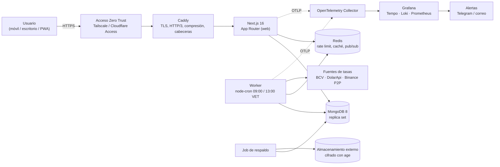
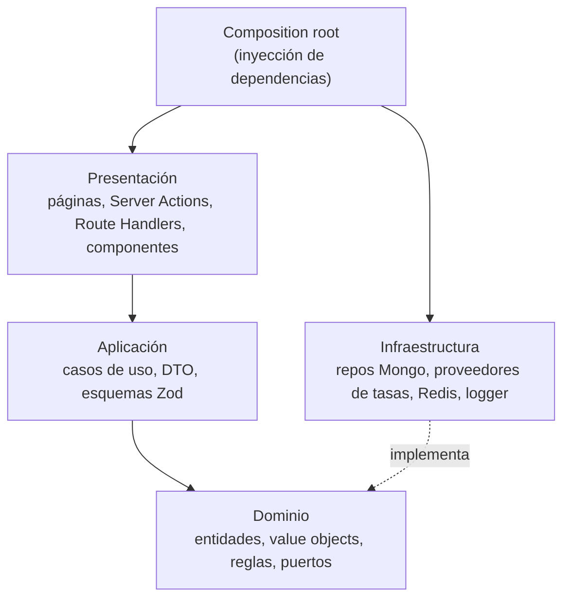
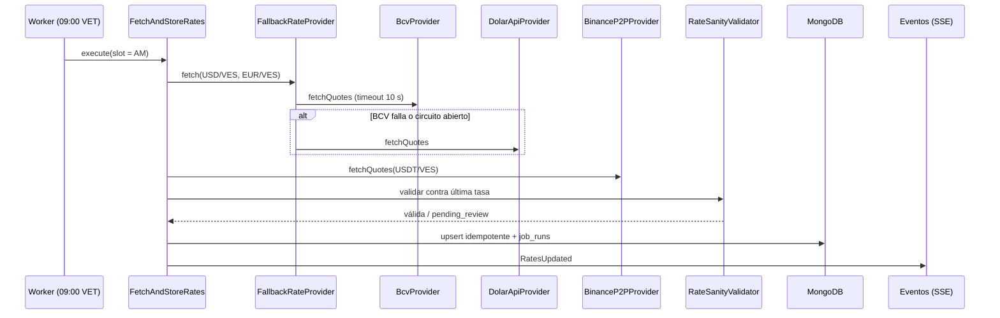
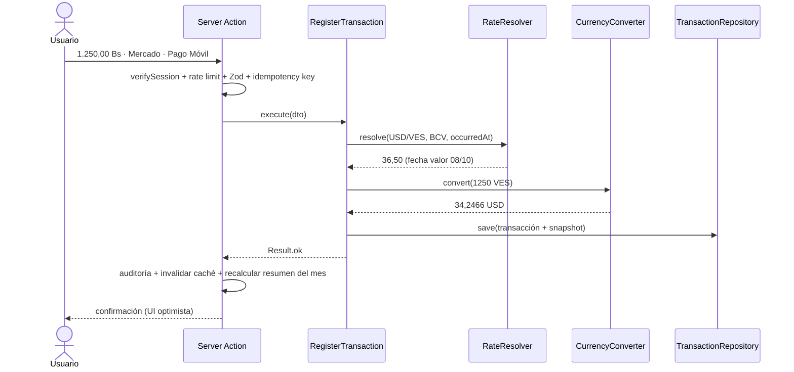
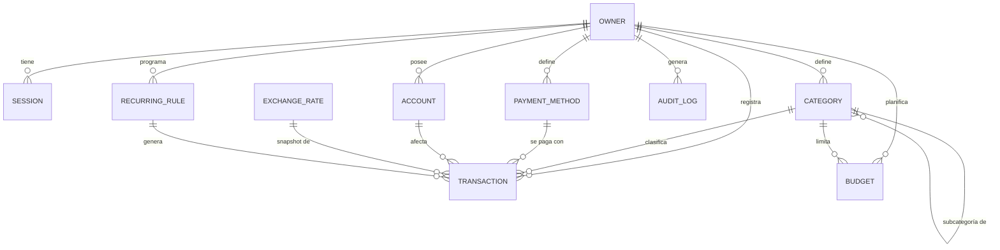
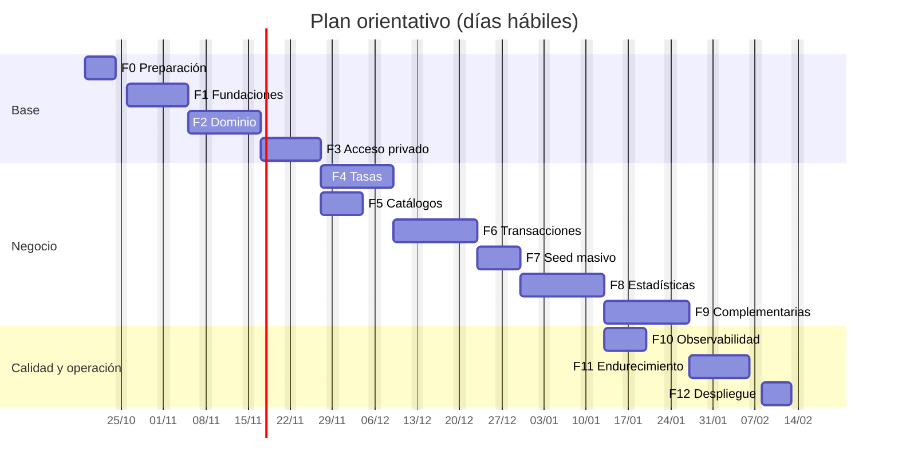

# Sistema Administrativo de Finanzas Personales — Planificación

> **Estado:** Planificación. No se inicia el desarrollo hasta aprobar este documento.
> **Versión:** 1.0 — 2026-10-08
> **Autor:** Juan Rodriguez
> **Ubicación:** `IA/sistema-administrativo/planificacion.md`

---

## Índice

1. [Resumen ejecutivo](#1-resumen-ejecutivo)
2. [Alcance](#2-alcance)
3. [Requerimientos](#3-requerimientos)
4. [Supuestos, decisiones y preguntas abiertas](#4-supuestos-decisiones-y-preguntas-abiertas)
5. [Stack tecnológico](#5-stack-tecnológico)
6. [Arquitectura](#6-arquitectura)
7. [Dominio multimoneda y tasas de cambio](#7-dominio-multimoneda-y-tasas-de-cambio)
8. [Modelo de datos (MongoDB)](#8-modelo-de-datos-mongodb)
9. [Acceso privado sin registro](#9-acceso-privado-sin-registro)
10. [Seguridad: OWASP Top 10 y rate limiting](#10-seguridad-owasp-top-10-y-rate-limiting)
11. [Observabilidad y telemetría en tiempo real](#11-observabilidad-y-telemetría-en-tiempo-real)
12. [Rendimiento](#12-rendimiento)
13. [SEO para un sistema privado](#13-seo-para-un-sistema-privado)
14. [UI/UX y diseño responsive](#14-uiux-y-diseño-responsive)
15. [Estrategia de pruebas (TDD)](#15-estrategia-de-pruebas-tdd)
16. [Estándares de código: SOLID, Clean Code y comentarios](#16-estándares-de-código-solid-clean-code-y-comentarios)
17. [Datos de prueba (seed)](#17-datos-de-prueba-seed)
18. [Infraestructura, despliegue y CI/CD](#18-infraestructura-despliegue-y-cicd)
19. [Respaldos y recuperación](#19-respaldos-y-recuperación)
20. [Plan por fases y tareas](#20-plan-por-fases-y-tareas)
21. [Definición de Hecho (DoD)](#21-definición-de-hecho-dod)
22. [Riesgos y mitigaciones](#22-riesgos-y-mitigaciones)
23. [Propuestas de mejora de rendimiento y seguridad](#23-propuestas-de-mejora-de-rendimiento-y-seguridad)
24. [Glosario](#24-glosario)
25. [Anexos](#25-anexos)

---

## 1. Resumen ejecutivo

Aplicación web **privada y de un solo usuario** (el propietario) para registrar, filtrar y analizar ingresos y egresos en **dólares (USD)** y **bolívares digitales (VES, "Bs.")**. El sistema consulta automáticamente las tasas **BCV USD**, **BCV EUR** y **USDT** a las **9:00 a. m.** y **1:00 p. m.** (hora de Venezuela) y guarda en cada transacción una **fotografía (snapshot) de la tasa aplicada**, para que el valor en dólares de un pago hecho en bolívares nunca cambie de forma retroactiva.

Se construirá como un **monolito modular** con **Next.js** (frontend y backend), **MongoDB**, **Tailwind CSS**, siguiendo **TDD**, **SOLID**, **Clean Code** (con código comentado), **Clean Architecture**, **OWASP Top 10:2025**, **rate limiting**, **observabilidad con OpenTelemetry** y verificación en **todas las resoluciones** de pantalla.

**Principios rectores**

| Principio | Qué significa en este proyecto |
| --- | --- |
| Privacidad por diseño | Sin registro público, acceso con 2FA, no indexable, telemetría sin datos financieros, idealmente detrás de una red privada (Zero Trust). |
| Exactitud monetaria | Nunca usar `number` de punto flotante para dinero; decimales exactos y reglas de redondeo documentadas. |
| Test-first | Ninguna línea de producción sin una prueba que falle primero. |
| Observable desde el día 1 | Logs estructurados, trazas y métricas desde la Fase 1, no al final. |
| Simplicidad | Monolito modular desplegable con un solo `docker compose up`; sin microservicios innecesarios. |

---

## 2. Alcance

### 2.1 Dentro del alcance

- Registro de ingresos y egresos por categoría, método de pago y moneda.
- Gestión de categorías (ingresos/egresos) y métodos de pago.
- Tasas BCV USD, BCV EUR y USDT, con actualización automática 9:00 y 13:00 (America/Caracas).
- Multimoneda USD/VES con conversión y snapshot de tasa por transacción.
- Estadísticas, filtros, búsqueda y exportación.
- Acceso privado de un único propietario (sin registro).
- Interfaz responsive (desde 280 px hasta 2560 px) e instalable como PWA.
- Datos falsos masivos para pruebas.

### 2.2 Fuera del alcance (v1)

- Multiusuario, registro público o roles.
- Conexión automática con bancos (no hay open banking en Venezuela).
- Contabilidad empresarial, facturación o declaraciones fiscales.
- Aplicación nativa (se cubre con PWA).
- Inversiones avanzadas (portafolios, acciones). Se puede evaluar en v2.

---

## 3. Requerimientos

### 3.1 Requerimientos funcionales solicitados

| ID | Requisito | Criterios de aceptación (resumen) | Fase |
| --- | --- | --- | --- |
| RF-01 | Sistema privado sin registro | No existe ruta ni endpoint de registro; el propietario se crea por CLI; toda ruta exige sesión excepto `/login` y `/api/health`. | F3 |
| RF-02 | Registrar ingresos por categoría | Crear/editar/eliminar ingresos con categoría, método de pago, moneda, fecha y descripción. | F6 |
| RF-03 | Registrar egresos por categoría | Igual que RF-02 para egresos. | F6 |
| RF-04 | Métodos de pago | CRUD de métodos (Pago Móvil, Zelle, efectivo USD, etc.) con moneda por defecto; no se borran si están en uso (se archivan). | F5 |
| RF-05 | Categorías de ingresos y egresos | CRUD por tipo, con color, ícono, orden y subcategorías de un nivel. | F5 |
| RF-06 | Tasa del día BCV USD, BCV EUR y USDT | Widget con las 3 tasas, variación y brecha; histórico con gráfico y tabla. | F4 |
| RF-07 | Multimoneda USD y Bs. | Toda transacción guarda el monto original y sus equivalentes en USD y VES. | F2, F6 |
| RF-08 | Pago en Bs. registra USD con la tasa del día | El equivalente en USD se calcula con la tasa vigente en la fecha/hora del pago y queda inmutable. | F6 |
| RF-09 | Estadísticas | KPIs, distribución por categoría, evolución mensual, comparación de períodos, etc. (sección 14.4). | F8 |
| RF-10 | Responsive | Sin desbordes ni pérdida de funciones entre 280 px y 2560 px; verificado con la matriz de la sección 15.6. | Todas / F11 |
| RF-11 | Actualizar tasas a las 9:00 y 13:00 | Tarea programada en zona America/Caracas con reintentos, idempotencia y alertas. | F4 |
| RF-12 | Filtrar gastos e ingresos | Por fecha, tipo, categoría, método, moneda, monto, texto y etiquetas; combinables y guardados en la URL. | F6 |
| RF-13 | Datos falsos masivos | Script reproducible con perfiles `small`, `medium`, `large` y `stress`. | F7 |

### 3.2 Características faltantes detectadas (propuestas)

Priorización **MoSCoW**: *Must* (imprescindible), *Should* (muy recomendable), *Could* (deseable), *Won't* (no en v1).

| ID | Característica | Por qué hace falta | Prioridad |
| --- | --- | --- | --- |
| CP-01 | **Tasa manual / corrección de tasa** | Las fuentes fallan y muchos comercios cobran con su propia tasa. | Must |
| CP-02 | **Elegir el tipo de tasa por transacción** (BCV, USDT, manual) | En Venezuela se paga con distintas tasas según el comercio. | Must |
| CP-03 | **Gestión de sesiones y 2FA** | Un sistema privado sin 2FA depende de una sola contraseña. | Must |
| CP-04 | **Registro de auditoría** | Trazabilidad de accesos y cambios (OWASP A09). | Must |
| CP-05 | **Respaldos cifrados automáticos** con restauración probada | Los datos financieros son irrecuperables si se pierden. | Must |
| CP-06 | **Cuentas / billeteras con saldo** (Banesco Bs., Efectivo USD, Binance USDT…) | Saber *cuánto tengo y dónde*, no solo cuánto gasté. | Should (muy recomendado) |
| CP-07 | **Cambio de divisas y transferencias entre cuentas** | Vender USD por Bs. no es ingreso ni egreso; sin este tipo las estadísticas se distorsionan. | Should |
| CP-08 | **Presupuestos mensuales por categoría** con alertas al 80 % y 100 % | Convierte las estadísticas en control del gasto. | Should |
| CP-09 | **Transacciones recurrentes** (alquiler, suscripciones, salario) | Evita registrar a mano lo que se repite. | Should |
| CP-10 | **Etiquetas (tags)** | Clasificación transversal (p. ej. "viaje-mérida"). | Should |
| CP-11 | **Papelera** (borrado lógico y restauración) | Evita pérdidas por error. | Should |
| CP-12 | **Exportar** CSV/XLSX/PDF e **importar** CSV | Portabilidad de los datos y carga histórica. | Should |
| CP-13 | **Modo privacidad** (ocultar montos con un toque; difuminar al cambiar de app) | Uso en lugares públicos. | Should |
| CP-14 | **Modo oscuro** | Comodidad y batería en OLED. | Should |
| CP-15 | **PWA instalable** | Acceso rápido desde el teléfono, como una app. | Should |
| CP-16 | **Convertidor rápido** USD ↔ Bs. ↔ EUR ↔ USDT | Consulta diaria muy frecuente. | Should |
| CP-17 | **Página de estado del sistema** | Ver si la última actualización de tasas funcionó. | Should |
| CP-18 | **Brecha cambiaria y pérdida por devaluación** | Entender cuánto valor pierden los Bs. mantenidos. | Could |
| CP-19 | **Metas de ahorro** | Motivación y planificación. | Could |
| CP-20 | **Comprobantes adjuntos** (imagen/PDF) | Respaldo de pagos; implica riesgos de subida de archivos. | Could |
| CP-21 | **Notificaciones privadas** (bot de Telegram propio) | Alertas de presupuesto, tasas y seguridad. | Could |
| CP-22 | **Comisiones e IGTF** en pagos con divisas | Refleja el costo real de un pago. | Could |
| CP-23 | Deudas y préstamos (por cobrar / por pagar) | Útil, pero amplía mucho el alcance. | Won't (v2) |

### 3.3 Requerimientos no funcionales

| ID | Categoría | Requisito medible |
| --- | --- | --- |
| RNF-01 | Seguridad | Cumplir OWASP Top 10:2025 y, como guía, OWASP ASVS nivel 2. Cero hallazgos altos en DAST (ZAP). |
| RNF-02 | Privacidad | Ningún monto, descripción ni nota en logs, trazas o métricas. No indexable por buscadores. |
| RNF-03 | Rendimiento | LCP < 2,0 s (4G, gama media), INP < 200 ms, CLS < 0,05; API p95 < 300 ms; JS inicial < 150 KB gzip por ruta. |
| RNF-04 | Disponibilidad | 99,5 % mensual; la caída de una fuente de tasas no detiene el sistema. |
| RNF-05 | Exactitud | Diferencia máxima de 0,01 en cualquier total mostrado frente a la suma exacta. |
| RNF-06 | Mantenibilidad | Cobertura ≥ 95 % dominio, ≥ 90 % aplicación, ≥ 85 % global; mutation score ≥ 80 % en dominio. |
| RNF-07 | Observabilidad | 100 % de peticiones con trazas y `requestId`; alertas en menos de 5 minutos. |
| RNF-08 | Accesibilidad | WCAG 2.2 AA; cero violaciones serias o críticas en axe. |
| RNF-09 | Compatibilidad | Últimas 2 versiones de Chrome, Edge, Firefox y Safari (incluye iOS y Android); 280–2560 px. |
| RNF-10 | Localización | Idioma `es-VE`; formato `1.234,56 Bs.` y `$1,234.56`; zona horaria de negocio `America/Caracas` (UTC−4, sin horario de verano). |
| RNF-11 | Recuperación | RPO ≤ 24 h, RTO ≤ 2 h; simulacro de restauración mensual automatizado. |

---

## 4. Supuestos, decisiones y preguntas abiertas

### 4.1 Supuestos

1. Un solo usuario (el propietario); el modelo de datos guarda igualmente `ownerId` para no cerrar la puerta a futuro.
2. La moneda de reporte principal es **USD**; VES es la secundaria. Ambas se muestran siempre.
3. "Bs.D" se modela con el código ISO 4217 **VES**. USDT se trata como pseudo-moneda (no ISO).
4. La fuente oficial es el **BCV**; publica la tasa con hasta 8 decimales y con una **"fecha valor"** (normalmente la publica una tarde y rige para el siguiente día hábil).
5. Los fines de semana y feriados bancarios no hay nueva tasa BCV: se usa la última vigente.
6. Los servidores trabajan en **UTC**; las reglas de negocio ("el día", "9:00 a. m.") se calculan en **America/Caracas**.

### 4.2 Decisiones de arquitectura (ADR resumidos)

Cada decisión se documentará en `docs/adr/NNN-titulo.md` (formato: contexto, decisión, alternativas, consecuencias).

| ADR | Decisión | Alternativas descartadas | Motivo |
| --- | --- | --- | --- |
| 001 | Monolito modular en Next.js con Clean Architecture por módulo | Microservicios; backend Express separado | Un usuario, bajo tráfico: la complejidad de microservicios no se justifica. |
| 002 | MongoDB 8 en **replica set** (aunque sea de 1 nodo) | Standalone | Habilita transacciones multi-documento y Change Streams (tiempo real). |
| 003 | Dinero en **Decimal128** en BD y `big.js` en la aplicación | `number`, enteros en céntimos | Las tasas necesitan 8 decimales; Decimal128 evita errores de coma flotante. |
| 004 | Autenticación propia de propietario único (Argon2id + TOTP + sesiones opacas) | Auth.js con Credentials; proveedores OAuth | No hay registro ni terceros; sesiones en BD permiten revocar al instante. |
| 005 | Proveedores de tasas con patrón Strategy + cadena de respaldo + circuit breaker | Una sola fuente | Las fuentes venezolanas son inestables. |
| 006 | Tareas programadas en un **worker** separado (node-cron, TZ Caracas) | Cron dentro del proceso web | Responsabilidad única; reinicios del web no afectan el cron. |
| 007 | Autohospedado en VPS con Docker Compose detrás de acceso **Zero Trust** | Vercel + Atlas | Máxima privacidad y control. Vercel queda como alternativa documentada. |
| 008 | Observabilidad con OpenTelemetry + stack Grafana (Tempo, Loki, Prometheus) | SaaS propietario | Datos de telemetría bajo control propio. |
| 009 | Redis para rate limiting, caché y pub/sub | Rate limit en memoria | Persistente entre reinicios y atómico. |
| 010 | Identificadores de código en **inglés**, comentarios y documentación en **español** | Todo en español | Convención de la industria y de las librerías; los comentarios explican en el idioma del dueño. |

### 4.3 Preguntas abiertas (decidir en la Fase 0)

1. **Hospedaje:** ¿VPS propio (recomendado) o Vercel + MongoDB Atlas?
2. **USDT:** ¿usar Binance P2P (promedio entre compra y venta) o un agregador? ¿Qué lado (compra, venta o promedio)?
3. **Tasa por defecto** para convertir pagos en Bs.: ¿BCV (propuesto) o USDT?
4. ¿Se aprueba el módulo de **cuentas/billeteras** (CP-06) y **cambio de divisas** (CP-07) para la v1? Afecta el modelo de datos.
5. ¿Agregar una tercera consulta a las **~17:00** para capturar la tasa BCV del día siguiente apenas se publica?
6. ¿Se quieren **notificaciones por Telegram**?
7. ¿Se quieren **comprobantes adjuntos**? (Implica almacenamiento y controles de subida de archivos.)
8. ¿Hay datos históricos (Excel, notas) para importar?

---

## 5. Stack tecnológico

> Versiones a confirmar al iniciar (usar la última estable de cada una). Las indicadas son las de referencia a la fecha del documento.

| Capa | Tecnología | Uso / justificación |
| --- | --- | --- |
| Runtime | **Node.js 24 LTS** | Soporte largo; `.nvmrc` y `engines` fijados. |
| Gestor de paquetes | **pnpm 10** | `minimumReleaseAge` y `onlyBuiltDependencies` mitigan ataques a la cadena de suministro. |
| Framework | **Next.js 16 (App Router)** + **React 19** + **TypeScript strict** | Frontend y backend en uno; Server Components, Server Actions, Route Handlers, `proxy.ts` (antes `middleware.ts`), React Compiler. |
| Estilos | **Tailwind CSS v4** | Utilidades, *mobile-first*, tokens de diseño, modo oscuro. |
| Componentes | **Radix UI / shadcn/ui** + **lucide-react** | Componentes accesibles sin estilos impuestos. |
| Gráficos | **Recharts** (carga diferida) | Suficiente para el volumen; alternativa ECharts si se necesitan >50k puntos. |
| Formularios | Server Actions + `useActionState` + **Zod** compartido cliente/servidor | Validación única y mejora progresiva. |
| Fechas | **date-fns v4** + `@date-fns/tz` | Cálculos en America/Caracas sin depender de la TZ del servidor. |
| Decimales | **big.js** (o decimal.js) | Aritmética monetaria exacta. |
| Base de datos | **MongoDB 8** (replica set) + **Mongoose** | Esquemas, validación, `sanitizeFilter`, transacciones. |
| Caché / rate limit / pub-sub | **Redis 7** (o Valkey) + `rate-limiter-flexible` | Ventana deslizante atómica; caché de agregaciones. |
| Autenticación | `@node-rs/argon2`, `otplib` (TOTP), `@simplewebauthn/server` (passkeys, opcional) | Sin registro; propietario único. |
| Scraping / HTTP | `undici` (fetch nativo) + `cheerio` + `opossum` (circuit breaker) | Tasas BCV, DolarApi, Binance P2P. |
| Tareas programadas | `node-cron` en un worker (TZ America/Caracas) | 9:00 y 13:00; respaldos; recurrentes. |
| Observabilidad | **OpenTelemetry** (`instrumentation.ts`), **Pino**, OTel Collector, **Grafana + Tempo + Loki + Prometheus** | Trazas, logs y métricas en tiempo real. |
| Errores | Sentry autohospedado o **GlitchTip** (opcional) | Agrupación de errores sin enviar datos a terceros. |
| Pruebas | **Vitest**, **React Testing Library**, **MSW**, **Testcontainers** (Mongo/Redis), **Playwright**, **@axe-core/playwright**, **fast-check**, **Stryker**, **k6**, **Lighthouse CI**, **OWASP ZAP** | Pirámide completa de pruebas (sección 15). |
| Datos falsos | **@faker-js/faker** (locale `es`) con semilla fija | Reproducibilidad. |
| Calidad | ESLint (typescript-eslint strict, sonarjs, security, unicorn, jsx-a11y, jsdoc), Prettier, Husky, lint-staged, commitlint | Reglas de Clean Code automatizadas. |
| Contenedores | Docker + Docker Compose, imagen `standalone` de Next.js, usuario no root | Despliegue reproducible. |
| Proxy inverso | **Caddy** | TLS automático, HTTP/3, compresión br/zstd, cabeceras. |
| Acceso privado | **Tailscale** o **Cloudflare Tunnel + Access** | La app no queda expuesta a todo Internet. |
| CI/CD | GitHub Actions + CodeQL + Semgrep + gitleaks + osv-scanner + Trivy + cosign | Calidad y seguridad en cada PR. |

---

## 6. Arquitectura

### 6.1 Vista general



### 6.2 Clean Architecture por módulo

Cada módulo de negocio (transacciones, tasas, catálogos, estadísticas…) tiene cuatro capas. **Las dependencias solo apuntan hacia adentro**: la presentación conoce la aplicación, la aplicación conoce el dominio, y la infraestructura implementa interfaces (puertos) del dominio o de la aplicación.



| Capa | Contiene | No puede |
| --- | --- | --- |
| Dominio | `Money`, `Currency`, `ExchangeRate`, `Transaction`, `Category`, reglas de conversión, puertos (`TransactionRepository`, `Clock`…) | Importar Next.js, Mongoose, Redis o cualquier librería de infraestructura. |
| Aplicación | Casos de uso (`RegisterTransaction`, `FetchAndStoreRates`, `GetDashboardStats`), DTO, validación Zod | Conocer detalles de HTTP o de la BD. |
| Infraestructura | Repositorios Mongoose, mappers, proveedores HTTP, rate limiter, logger, telemetría | Contener reglas de negocio. |
| Presentación | App Router, Server Actions, Route Handlers, componentes React | Acceder directamente a la BD o a Mongoose. |

Una regla de ESLint (`eslint-plugin-boundaries` o `import/no-restricted-paths`) impedirá romper estas dependencias.

### 6.3 Estructura de carpetas propuesta

El proyecto Next.js vivirá en esta misma carpeta (`IA/sistema-administrativo/`).

```text
sistema-administrativo/
├── planificacion.md                  ← este documento
├── .github/workflows/                CI/CD
├── docker/                           Dockerfiles, Caddyfile, compose, otel-collector
├── docs/
│   ├── adr/                          Decisiones de arquitectura
│   ├── runbooks/                     Procedimientos operativos (tasas caídas, restaurar respaldo…)
│   └── threat-model.md               Modelado de amenazas STRIDE
├── scripts/                          owner-create, seed, seed-verify, backup, restore
├── src/
│   ├── app/                          Next.js App Router (capa de presentación)
│   │   ├── (public)/login/
│   │   ├── (private)/
│   │   │   ├── layout.tsx            Verifica sesión (DAL) + navegación
│   │   │   ├── dashboard/
│   │   │   ├── transacciones/
│   │   │   ├── categorias/
│   │   │   ├── metodos-de-pago/
│   │   │   ├── cuentas/              (si se aprueba CP-06)
│   │   │   ├── tasas/
│   │   │   ├── estadisticas/
│   │   │   ├── presupuestos/
│   │   │   ├── ajustes/
│   │   │   └── sistema/estado/
│   │   ├── api/
│   │   │   ├── health/route.ts       Liveness / readiness
│   │   │   ├── cron/rates/route.ts   Disparo protegido (alternativa a worker)
│   │   │   ├── events/route.ts       Server-Sent Events (tiempo real)
│   │   │   ├── telemetry/vitals/route.ts
│   │   │   └── export/route.ts
│   │   ├── robots.ts                 Disallow total
│   │   ├── manifest.ts               PWA
│   │   ├── error.tsx / global-error.tsx / not-found.tsx
│   │   └── layout.tsx
│   ├── modules/
│   │   ├── shared/                   Result, errores, Money, Currency, Clock
│   │   ├── auth/
│   │   ├── catalog/                  Categorías, métodos de pago, cuentas
│   │   ├── transactions/
│   │   │   ├── domain/               Entidades, VO, reglas, puertos
│   │   │   ├── application/          Casos de uso, DTO, esquemas Zod
│   │   │   ├── infrastructure/       Repos Mongo, mappers
│   │   │   └── presentation/         Server Actions y componentes del módulo
│   │   ├── exchange-rates/
│   │   ├── statistics/
│   │   ├── budgets/
│   │   └── audit/
│   ├── platform/                     Infraestructura transversal
│   │   ├── config/env.ts             Variables de entorno validadas con Zod
│   │   ├── db/                       Cliente Mongo (singleton), transacciones
│   │   ├── cache/                    Redis
│   │   ├── rate-limit/
│   │   ├── security/                 CSP, cabeceras, CSRF, cifrado
│   │   └── observability/            Logger, tracer, métricas
│   ├── ui/                           Design system (Button, Input, Card, Dialog…)
│   ├── composition-root.ts           Inyección de dependencias
│   ├── instrumentation.ts            Arranque de OpenTelemetry
│   ├── proxy.ts                      Cabeceras, nonce CSP, rate limit global, redirección a /login
│   └── worker/                       Proceso de tareas programadas
└── tests/
    ├── e2e/                          Playwright (flujos y matriz de resoluciones)
    ├── integration/                  Repos y proveedores contra Mongo/Redis reales
    ├── contract/                     Contratos compartidos (repos fake vs Mongo, proveedores)
    ├── fixtures/                     HTML/JSON reales de BCV, DolarApi, Binance
    ├── factories/                    Builders de datos de prueba
    └── load/                         Escenarios k6
```

### 6.4 Flujo de lectura y escritura en Next.js

| Operación | Mecanismo | Reglas |
| --- | --- | --- |
| Leer datos para una página | **Server Component** → caso de uso (llamada directa, sin HTTP interno) | Pasar al cliente solo DTO mínimos; nunca entidades con campos sensibles. |
| Mutaciones desde la UI | **Server Action** envuelta en `createSafeAction(schema, handler, options)` | Cada acción: verifica sesión → rate limit → valida con Zod → ejecuta caso de uso → audita → invalida caché. |
| Cron, SSE, health, exportación, telemetría | **Route Handlers** | Autenticación propia (sesión o secreto HMAC) y rate limit. |
| Verificación de sesión | **DAL** (`verifySession()` memorizada con `cache()` de React) | Se llama en *cada* página, acción y handler. `proxy.ts` solo redirige por comodidad, **no** es la barrera de seguridad (lección del CVE-2025-29927). |
| Código solo de servidor | `import 'server-only'` | Evita que repositorios o secretos terminen en el bundle del cliente. |

### 6.5 Patrones de diseño previstos

| Patrón | Dónde | Beneficio |
| --- | --- | --- |
| Repository | Acceso a datos de cada agregado | Dominio independiente de Mongo; fakes en memoria para pruebas. |
| Strategy | Proveedores de tasas; política de resolución de tasa por fuente; exportadores (CSV, XLSX, PDF) | Abierto a extensión sin modificar código existente. |
| Chain of Responsibility / Composite | `FallbackRateProvider` (BCV → DolarApi → última conocida) | Resiliencia. |
| Circuit Breaker | Llamadas HTTP externas | No insistir contra una fuente caída. |
| Value Object | `Money`, `Currency`, `ExchangeRate`, `DateRange` | Invariantes garantizadas e inmutabilidad. |
| Factory / Builder | Creación de transacciones y datos de prueba | Construcción válida y legible. |
| Domain Events | `TransactionRegistered`, `RatesUpdated` | Desacopla recalcular resúmenes, invalidar caché y notificar por SSE. |
| Decorator | Casos de uso con trazas/métricas/auditoría | Observabilidad sin ensuciar la lógica. |
| Result | Retorno de casos de uso | Errores esperados sin excepciones. |

---

## 7. Dominio multimoneda y tasas de cambio

### 7.1 Monedas, precisión y redondeo

| Moneda | Código | Decimales de presentación | Decimales internos | Símbolo / formato `es-VE` |
| --- | --- | --- | --- | --- |
| Dólar estadounidense | USD | 2 | 4 | `$ 1.234,56` (configurable a `$1,234.56`) |
| Bolívar digital | VES | 2 | 4 | `Bs. 1.234,56` |
| Euro | EUR | 2 | 4 | `€ 1.234,56` |
| Tether | USDT | 2 | 6 | `1.234,56 USDT` |
| **Tasas** | — | 4 (UI) | 8 | `36,47230000` |

**Reglas**

- Nunca usar `number` para dinero. En BD: `Decimal128`; en la aplicación: `big.js` encapsulado en el value object `Money`.
- Se redondea **solo al presentar** o al persistir con la precisión interna. Modo: `ROUND_HALF_EVEN` (bancario) para almacenamiento y `ROUND_HALF_UP` para presentación; documentado en un ADR.
- Los totales se calculan sumando valores internos (4 decimales) y se redondean al final, nunca sumando valores ya redondeados.
- Entrada de montos en formato venezolano (`1.234,56`) y anglosajón (`1,234.56`) con un parser probado por TDD.

### 7.2 Value object `Money` (boceto)

```ts
/**
 * Representa una cantidad de dinero en una moneda concreta.
 * Es inmutable: cada operación devuelve una instancia nueva.
 *
 * Por qué existe: centraliza la aritmética decimal exacta y evita
 * mezclar monedas por accidente (sumar USD con VES lanza un error).
 */
export class Money {
  private constructor(
    private readonly amount: Big,
    readonly currency: Currency,
  ) {}

  /** Crea un Money validando que el monto sea finito y no negativo. */
  static of(value: string, currency: Currency): Money { /* ... */ }

  /** Suma dos montos de la misma moneda. */
  add(other: Money): Money { /* ... */ }

  /** Convierte a otra moneda usando una tasa explícita (nunca implícita). */
  convert(rate: ExchangeRate): Money { /* ... */ }
}
```

### 7.3 Fuentes de tasas

| Par | Fuente primaria | Respaldo | Notas |
| --- | --- | --- | --- |
| USD/VES (BCV) | Scraping de `bcv.org.ve` con `cheerio` | API comunitaria (p. ej. DolarApi Venezuela) | Leer también la "fecha valor". El sitio del BCV ha tenido cadenas de certificados incompletas: **se configura la CA intermedia, nunca se desactiva la verificación TLS**. |
| EUR/VES (BCV) | Scraping de `bcv.org.ve` | API comunitaria | Mismo documento HTML. |
| USDT/VES | Binance P2P (búsqueda de anuncios USDT/VES, compra y venta) | API comunitaria de "paralelo" / última conocida | Mediana de los primeros N anuncios por lado, descartando valores atípicos; se guarda compra, venta y promedio. Endpoint no oficial: revisar términos de uso. |
| Cualquiera | Tasa **manual** del propietario | — | Siempre disponible; queda auditada. |

> Los selectores HTML y endpoints exactos se confirman en la Fase 0 capturando *fixtures* reales que se usan en pruebas de contrato: si la fuente cambia su formato, una prueba falla antes que producción.

**Contrato del proveedor (boceto)**

```ts
/**
 * Puerto que toda fuente de tasas debe implementar.
 * Contrato (LSP): devuelve cotizaciones válidas o lanza
 * ProviderUnavailableError; nunca devuelve datos parciales o inválidos.
 */
export interface ExchangeRateProvider {
  /** Nombre único para logs y métricas (p. ej. "bcv", "binance-p2p"). */
  readonly name: string;
  /** Indica si este proveedor puede cotizar el par solicitado. */
  supports(pair: CurrencyPair): boolean;
  /** Obtiene las cotizaciones; respeta la señal de cancelación (timeout). */
  fetchQuotes(pairs: CurrencyPair[], signal: AbortSignal): Promise<RateQuote[]>;
}
```

### 7.4 Actualización programada (9:00 y 13:00)

| Aspecto | Diseño |
| --- | --- |
| Horario | `0 9 * * *` y `0 13 * * *` con `timezone: 'America/Caracas'` (equivale a 13:00 y 17:00 UTC). Configurable por variable de entorno. |
| Ejecutor | Worker independiente con `node-cron`. Alternativa: `/api/cron/rates` protegido con secreto (Vercel Cron, GitHub Actions o cron del sistema). |
| Reintentos | Si falla: 09:05, 09:15, 09:30 y 10:00 (backoff exponencial con jitter). Tras el último intento: alerta. |
| Idempotencia | Índice único `(pair, source, effectiveDate, slot)`; repetir la ejecución no duplica. |
| Recuperación ("catch-up") | Al iniciar el worker, si falta la franja vigente de hoy, se ejecuta de inmediato. |
| Bloqueo | Lock distribuido en Redis (`SET NX PX`) para que dos instancias no ejecuten a la vez. |
| Registro | Colección `job_runs` con inicio, fin, estado, intentos, proveedor usado y error. |
| Tiempo real | Al guardar tasas: evento `RatesUpdated` → invalidar caché → notificar a la UI por SSE. |
| Manual | Botón "Actualizar ahora" (limitado a 3 cada 10 minutos). |

### 7.5 Resolución de la tasa de una transacción

1. El usuario elige el **tipo de tasa** (por defecto la configurada; propuesta: BCV).
2. Se calcula la **fecha de negocio** del pago en America/Caracas.
3. Política por fuente (Strategy):
   - **BCV:** la tasa con mayor `effectiveDate` ≤ fecha de negocio (cubre fines de semana y feriados).
   - **USDT:** la captura (franja AM o PM) más reciente con `capturedAt` ≤ momento del pago; si el pago es anterior a toda captura del día, la última del día hábil anterior.
   - **Manual:** la tasa ingresada por el usuario.
4. Se calcula y **congela** el snapshot: `{ rateId, pair, source, value, effectiveDate }` + `amountUsd` + `amountVes`.
5. Si se edita el monto, la moneda o la fecha, se recalcula; si solo se edita la descripción o la categoría, la tasa no cambia. El usuario puede forzar "recalcular con la tasa de esa fecha".
6. Si no existe tasa para una fecha pasada (anterior al histórico), se exige una tasa manual.

**Ejemplo:** egreso de **1.250,00 Bs.** el 08/10/2026 a las 10:30 con BCV = 36,50 → `amountUsd = 1250 / 36,50 = 34,2466` (se muestra **$34,25**).

### 7.6 Validación de tasas obtenidas

- Valor > 0 y dentro de un rango plausible configurado.
- Variación frente a la última tasa válida: ≤ 10 % (BCV) y ≤ 15 % (USDT). Si se excede → estado `pending_review`, alerta y **se sigue usando la tasa anterior** hasta que el propietario la confirme.
- Validación cruzada: si BCV-scraping y la API de respaldo difieren > 0,5 % → alerta.
- Guardar un hash del documento fuente para auditoría (integridad, OWASP A08).

### 7.7 Secuencias

**Actualización de tasas**



**Registro de un egreso en bolívares**



---

## 8. Modelo de datos (MongoDB)

### 8.1 Diagrama entidad-relación



### 8.2 Colecciones

| Colección | Campos principales | Notas |
| --- | --- | --- |
| `owner` | `_id`, `username`, `passwordHash` (Argon2id), `totpSecretEnc` (AES-256-GCM), `recoveryCodes[]` (hash), `passkeys[]`, `preferences { reportCurrency, defaultRateSource, theme, privacyMode, numberFormat }`, `createdAt`, `updatedAt` | Documento único; índice único en `username`. |
| `sessions` | `_id`, `tokenHash` (SHA-256 + pepper), `ownerId`, `createdAt`, `lastSeenAt`, `expiresAt`, `ipHash`, `userAgent`, `mfaVerified` | Índice TTL en `expiresAt`; índice único en `tokenHash`. |
| `categories` | `_id`, `ownerId`, `type` (`income`/`expense`), `name`, `parentId?`, `color`, `icon`, `order`, `archivedAt?` | Único `(ownerId, type, parentId, name)`. |
| `payment_methods` | `_id`, `ownerId`, `name`, `kind` (`cash`, `mobile_payment`, `bank_transfer`, `debit_card`, `credit_card`, `zelle`, `crypto`, `paypal`, `other`), `defaultCurrency`, `archivedAt?` | Único `(ownerId, name)`. |
| `accounts` *(CP-06)* | `_id`, `ownerId`, `name`, `currency`, `initialBalance` (Decimal128), `archivedAt?` | El saldo se calcula por agregación (y se cachea). |
| `exchange_rates` | `_id`, `pair` (`USD/VES`, `EUR/VES`, `USDT/VES`), `source` (`BCV`, `BINANCE_P2P`, `MANUAL`), `value` (Decimal128), `effectiveDate` (`YYYY-MM-DD`), `slot` (`AM`, `PM`, `MANUAL`), `capturedAt`, `provider`, `status` (`valid`, `pending_review`, `rejected`), `meta { buy, sell, sampleSize }`, `sourceHash` | Único `(pair, source, effectiveDate, slot)`. |
| `transactions` | ver 8.3 | Colección principal. |
| `budgets` *(CP-08)* | `_id`, `ownerId`, `categoryId`, `month` (`YYYY-MM`) o `recurring: true`, `limit` (Money USD) | Único `(ownerId, categoryId, month)`. |
| `recurring_rules` *(CP-09)* | `_id`, `ownerId`, plantilla de transacción, `rrule` (iCal), `nextRunAt`, `active` | El worker las materializa. |
| `monthly_summaries` | `_id: { ownerId, month }`, totales por tipo, por categoría, por método y por moneda (USD y VES) | Vista materializada con `$merge`. |
| `audit_logs` | `_id`, `at`, `action`, `entity`, `entityId`, `ipHash`, `userAgent`, `outcome`, `requestId` | Solo inserción; sin montos; retención 1 año (TTL) o según preferencia. |
| `job_runs` | `_id`, `job`, `slot`, `startedAt`, `finishedAt`, `status`, `attempts`, `provider`, `error` | TTL 90 días. |
| `idempotency_keys` | `_id` (clave), `result`, `createdAt` | TTL 24 h. |

### 8.3 Documento de transacción (ejemplo)

```json
{
  "_id": "ObjectId",
  "ownerId": "ObjectId",
  "type": "expense",
  "occurredAt": "2026-10-08T14:30:00.000Z",
  "period": { "date": "2026-10-08", "month": "2026-10", "year": 2026, "isoWeek": "2026-W41", "weekday": 4 },
  "description": "Compra semanal",
  "notes": null,
  "categoryId": "ObjectId",
  "paymentMethodId": "ObjectId",
  "accountId": "ObjectId",
  "tags": ["mercado"],
  "amount": { "value": "1250.0000", "currency": "VES" },
  "rateSnapshot": {
    "rateId": "ObjectId",
    "pair": "USD/VES",
    "source": "BCV",
    "value": "36.50000000",
    "effectiveDate": "2026-10-08"
  },
  "amountUsd": "34.2466",
  "amountVes": "1250.0000",
  "recurringRuleId": null,
  "deletedAt": null,
  "version": 1,
  "createdAt": "2026-10-08T14:31:02.000Z",
  "updatedAt": "2026-10-08T14:31:02.000Z"
}
```

> `period` se precalcula en America/Caracas al guardar: agrupar por mes o semana usa índices en lugar de calcular fechas en cada consulta.

### 8.4 Índices (regla ESR: Igualdad → Orden → Rango)

| Colección | Índice | Consulta que atiende |
| --- | --- | --- |
| `transactions` | `{ ownerId: 1, deletedAt: 1, occurredAt: -1 }` | Listado general por fecha. |
| `transactions` | `{ ownerId: 1, type: 1, occurredAt: -1 }` | Filtrar ingresos/egresos. |
| `transactions` | `{ ownerId: 1, categoryId: 1, occurredAt: -1 }` | Filtrar por categoría. |
| `transactions` | `{ ownerId: 1, paymentMethodId: 1, occurredAt: -1 }` | Filtrar por método. |
| `transactions` | `{ ownerId: 1, "period.month": 1, type: 1 }` | Resúmenes mensuales. |
| `transactions` | Índice de texto `{ description: "text", notes: "text" }` (idioma `spanish`) | Búsqueda. |
| `exchange_rates` | único `{ pair: 1, source: 1, effectiveDate: -1, slot: -1 }` | Resolución de tasa e idempotencia. |
| `sessions` | único `{ tokenHash: 1 }`; TTL `{ expiresAt: 1 }` | Sesiones. |

Una prueba automatizada ejecutará `explain()` sobre las consultas críticas y fallará si aparece `COLLSCAN` (sección 15.7).

### 8.5 Validación en la base de datos

Además de Mongoose y Zod, cada colección tendrá **JSON Schema validation** (`$jsonSchema`, `validationLevel: strict`) como defensa en profundidad: aunque haya un error en la app, la BD rechaza documentos malformados.

### 8.6 Agregaciones y resúmenes

- Las estadísticas leen de `monthly_summaries` (precalculado) y solo el mes en curso se agrega en vivo.
- Al registrar/editar/eliminar una transacción se **recalcula el mes afectado** con un pipeline idempotente terminado en `$merge` (más simple y robusto que sumar/restar incrementalmente).
- Las agregaciones usan `allowDiskUse: false` y proyecciones mínimas; se cachean en Redis con etiquetas invalidadas por eventos.

---

## 9. Acceso privado sin registro

| Elemento | Diseño |
| --- | --- |
| Sin registro | No existe página, ruta ni acción de registro. Cualquier `/register` responde 404. |
| Alta del propietario | `pnpm owner:create`: pide la contraseña por prompt oculto (no por argumento, para que no quede en el historial del shell), valida fortaleza (zxcvbn ≥ 3, mínimo 14 caracteres) y **se niega si ya existe un propietario**. |
| Contraseña | Argon2id (memoria ≥ 19 MiB, iteraciones ≥ 2, según OWASP Password Storage Cheat Sheet) + pepper en variable de entorno. |
| 2FA | **TOTP obligatorio**; enrolamiento con QR en el primer inicio de sesión; 10 códigos de recuperación de un solo uso (hasheados). Passkeys (WebAuthn) como mejora. |
| Sesión | Token opaco de 256 bits; en BD solo su hash. Cookie `__Host-session`, `HttpOnly`, `Secure`, `SameSite=Strict`, `Path=/`. |
| Expiración | Inactividad: 30 min. Absoluta: 12 h. Rotación del token tras login y tras verificar 2FA (evita fijación de sesión). |
| Gestión | Ver sesiones activas, cerrar una o todas ("botón de pánico"). |
| Bloqueos | Ver tabla de rate limiting (10.3); bloqueo progresivo y alerta al propietario. |
| Mensajes | Siempre genéricos ("Credenciales inválidas") y en tiempo constante. |
| Capa extra recomendada | Publicar el sistema **solo dentro de una red privada** (Tailscale) o detrás de Cloudflare Access con correo/huella del propietario: la app ni siquiera es visible para Internet. |

---

## 10. Seguridad: OWASP Top 10 y rate limiting

### 10.1 Mapeo OWASP Top 10:2025

| Riesgo | Amenaza concreta en este sistema | Controles | Verificación |
| --- | --- | --- | --- |
| **A01 Control de acceso roto** (incluye SSRF) | Acceder a datos sin sesión; llamar Server Actions directamente; forzar URLs externas. | `verifySession()` en cada página, acción y handler (no confiar solo en `proxy.ts`); denegar por defecto; filtrar siempre por `ownerId`; URLs de proveedores en **lista blanca fija** (el usuario nunca envía URLs). | E2E sin sesión contra todas las rutas y acciones → 401/redirect; prueba de que no hay `fetch` con URL dinámica. |
| **A02 Configuración insegura** | Cabeceras ausentes, BD expuesta, modo debug. | CSP estricta con nonce, HSTS (preload), `frame-ancestors 'none'`, `X-Content-Type-Options`, `Referrer-Policy: no-referrer`, `Permissions-Policy`, `poweredByHeader: false`; Mongo y Redis solo en red interna con auth; `security.javascriptEnabled: false` en Mongo; sin source maps públicos; variables validadas al arrancar. | ZAP baseline; prueba E2E de cabeceras; revisión de `docker compose config`. |
| **A03 Fallas en la cadena de suministro** | Paquete npm comprometido (p. ej. gusanos como Shai-Hulud en 2025). | Lockfile obligatorio (`--frozen-lockfile`); pnpm `minimumReleaseAge` (p. ej. 7 días) y scripts de instalación bloqueados salvo lista blanca; Renovate con agrupación; osv-scanner/`pnpm audit`; SBOM CycloneDX; Actions fijadas por SHA; imagen firmada con cosign; Trivy. | CI falla ante vulnerabilidades altas. |
| **A04 Fallas criptográficas** | Robo de contraseñas, secretos TOTP o respaldos. | Argon2id; TLS 1.3 (Caddy); secreto TOTP cifrado con AES-256-GCM; tokens de sesión hasheados; respaldos cifrados con `age`; disco cifrado en el VPS; rotación de secretos documentada. | Pruebas unitarias del módulo de cifrado; revisión de configuración TLS. |
| **A05 Inyección** | NoSQL injection (`{"$gt": ""}`), XSS en descripciones, CSV injection en exportes, regex maliciosas. | Zod en toda entrada (solo primitivos esperados); `mongoose.set('sanitizeFilter', true)` y `strictQuery`; nunca construir filtros con objetos del usuario; escapar regex o usar índice de texto; React escapa por defecto y se prohíbe `dangerouslySetInnerHTML` (ESLint); exportes CSV prefijan `'` a celdas que empiezan con `= + - @`. | Pruebas con cargas maliciosas; Semgrep; ZAP activo. |
| **A06 Diseño inseguro** | Abusos de lógica: montos absurdos, doble envío, paginación gigante. | Modelado STRIDE en Fase 0; límites de negocio (monto máx., longitudes, `pageSize ≤ 100`, rango de fechas ≤ 5 años); claves de idempotencia; casos de abuso convertidos en pruebas. | Lista de casos de abuso con prueba asociada. |
| **A07 Fallas de autenticación** | Fuerza bruta, credential stuffing, robo de sesión. | Sección 9: sin registro, 2FA obligatorio, bloqueo progresivo, rotación y expiración de sesión, `SameSite=Strict`, protección CSRF (Server Actions verifican `Origin`; Route Handlers mutantes exigen `Origin` válido + token). | E2E de bloqueo y expiración; prueba de fijación de sesión. |
| **A08 Fallas de integridad de software y datos** | Tasas manipuladas, cron disparado por terceros, respaldos alterados. | Endpoint de cron con secreto/HMAC y comparación en tiempo constante; validación de tasas (7.6); hash de documentos fuente; respaldos con checksum; sin scripts de CDNs externos (si los hubiera, SRI). | Pruebas de firma inválida → 401; prueba de tasa anómala → `pending_review`. |
| **A09 Fallas de registro y alertas** | Ataques sin detectar. | `audit_logs` (login ok/fallido, 2FA, cambios de contraseña, exportaciones, tasas manuales, borrados); logs estructurados con `requestId`; alertas (sección 11.5). | Prueba de que cada evento sensible genera auditoría. |
| **A10 Manejo incorrecto de condiciones excepcionales** | Fallos que exponen trazas o dejan el sistema en estado inconsistente. | Manejo centralizado de errores; `error.tsx` sin detalles técnicos (solo un ID de error); transacciones de Mongo en operaciones multi-documento; timeouts en todo I/O; **fail-closed** en autenticación y rate limit de login; Result types. | Pruebas de caos: Mongo/Redis/proveedores caídos. |

### 10.2 Cabeceras de seguridad (objetivo)

```text
Content-Security-Policy: default-src 'self'; script-src 'self' 'nonce-{N}' 'strict-dynamic';
  style-src 'self' 'nonce-{N}'; img-src 'self' data: blob:; font-src 'self';
  connect-src 'self'; frame-ancestors 'none'; base-uri 'none'; form-action 'self';
  object-src 'none'; upgrade-insecure-requests
Strict-Transport-Security: max-age=63072000; includeSubDomains; preload
X-Content-Type-Options: nosniff
X-Frame-Options: DENY
Referrer-Policy: no-referrer
Permissions-Policy: camera=(), microphone=(), geolocation=(), payment=(), usb=()
Cross-Origin-Opener-Policy: same-origin
Cross-Origin-Resource-Policy: same-origin
X-Robots-Tag: noindex, nofollow, noarchive, nosnippet
Cache-Control (páginas con datos): private, no-store
```

> La CSP con nonce obliga a renderizado dinámico; es aceptable porque todas las páginas son privadas y dinámicas.

### 10.3 Rate limiting

Algoritmo de **ventana deslizante** en Redis (`rate-limiter-flexible`), con cabeceras `RateLimit-Limit`, `RateLimit-Remaining`, `RateLimit-Reset` y `Retry-After` en respuestas `429`.

| Ámbito | Clave | Límite | Ventana | Acción al exceder |
| --- | --- | --- | --- | --- |
| Global (en `proxy.ts`) | IP | 300 peticiones | 1 min | 429 |
| Login | IP | 5 intentos fallidos | 15 min | 429 + espera exponencial |
| Login | usuario | 10 intentos fallidos | 1 h | Bloqueo 1 h + alerta |
| Verificación 2FA | sesión parcial | 5 intentos | 5 min | Invalida la sesión parcial |
| Server Actions de escritura | sesión | 60 | 1 min | 429 |
| Lecturas API | sesión | 120 | 1 min | 429 |
| Exportaciones | sesión | 10 | 1 h | 429 |
| "Actualizar tasas ahora" | sesión | 3 | 10 min | 429 |
| `/api/cron/rates` | IP + secreto | 6 | 1 h | 429 + alerta |
| `/api/telemetry/vitals` | IP | 60 | 1 min | Se descarta en silencio |
| Conexiones SSE | sesión | 3 simultáneas | — | Se rechaza la nueva |

**Reglas**

- La IP real se toma de `X-Forwarded-For` **solo** si la petición viene del proxy de confianza (Caddy); de lo contrario se ignora la cabecera (evita suplantación).
- Si Redis no responde: el login **falla cerrado** (deniega); las lecturas usan un limitador en memoria como respaldo.
- Cada rechazo incrementa la métrica `rate_limited_total{scope}` y, en login, genera auditoría.

### 10.4 Otros controles

- Límite de cuerpo: `serverActions.bodySizeLimit: '100kb'`.
- Sin asignación masiva: los DTO se mapean campo a campo a entidades (nunca `...req.body`).
- Validación de `ObjectId` antes de consultar.
- Usuarios de BD con privilegio mínimo: `app` (readWrite solo en su BD), `backup` (read), `seed` (solo en entornos no productivos).
- Contenedores: usuario no root, sistema de archivos de solo lectura, `no-new-privileges`, límites de CPU/memoria.
- Secretos fuera del repositorio (`.env` en `.gitignore`, gitleaks en pre-commit y CI).
- APIs de *taint* de React/Next (`experimental_taintObjectReference`) para impedir que el documento del propietario (con hashes) llegue a un componente cliente.

---

## 11. Observabilidad y telemetría en tiempo real

### 11.1 Los tres pilares

| Pilar | Implementación | Destino |
| --- | --- | --- |
| **Logs** | Pino en JSON; nivel por entorno; `requestId` y `traceId` vía `AsyncLocalStorage`; **redacción** de `password`, `token`, `cookie`, `authorization`, `totp`, `amount*`, `description`, `notes`. | stdout → OTel Collector / Grafana Alloy → **Loki** |
| **Trazas** | OpenTelemetry en `instrumentation.ts`: HTTP, Next.js, MongoDB, Redis, `fetch` a proveedores, spans propios por caso de uso (decorator). | OTLP → **Tempo** |
| **Métricas** | OTel Metrics: RED por ruta (tasa, errores, duración), runtime Node (event loop lag, heap, GC), métricas de negocio. | OTLP → **Prometheus** (o Mimir) |

### 11.2 Métricas de negocio y técnicas

| Métrica | Tipo | Etiquetas |
| --- | --- | --- |
| `http_server_duration` | histograma | ruta, método, estado |
| `use_case_duration` | histograma | caso de uso, resultado |
| `transactions_created_total` | contador | tipo, moneda (sin montos) |
| `rate_fetch_total` | contador | proveedor, par, resultado |
| `rate_fetch_duration` | histograma | proveedor |
| `exchange_rate_value` | gauge | par, fuente (dato público, no sensible) |
| `exchange_rate_age_hours` | gauge | par, fuente |
| `auth_login_total` | contador | resultado (ok, fail, locked) |
| `rate_limited_total` | contador | ámbito |
| `job_run_total` | contador | job, estado |
| `web_vitals` (LCP, INP, CLS, TTFB) | histograma | ruta, tipo de dispositivo |
| `mongo_pool_in_use` | gauge | — |

### 11.3 Tiempo real

- **Grafana** con refresco de 5 s y *live tail* de Loki.
- **Página in-app `/sistema/estado`** alimentada por **SSE**: estado de Mongo/Redis, última actualización de tasas por fuente, próxima ejecución, errores recientes (sin datos financieros).
- **Change Streams** de MongoDB (posibles gracias al replica set) o Redis pub/sub para emitir `RatesUpdated` y refrescar el widget de tasas en todas las pestañas abiertas sin recargar.
- **RUM**: `useReportWebVitals` envía métricas de rendimiento reales del navegador a `/api/telemetry/vitals` (con `sendBeacon`, con rate limit).
- Errores de cliente capturados en *error boundaries* y enviados con el `requestId`.

### 11.4 Paneles de Grafana

1. **Salud del sistema:** disponibilidad, latencia p50/p95/p99, errores 5xx, recursos.
2. **Tasas de cambio:** última captura, antigüedad, éxito por proveedor, valores y brecha.
3. **Seguridad:** logins (ok/fallidos/bloqueados), 429 por ámbito, sesiones activas, nuevos dispositivos.
4. **Rendimiento frontend:** Web Vitals por ruta y dispositivo.
5. **Base de datos:** operaciones lentas, uso del pool, tamaño de colecciones.

### 11.5 Alertas (Telegram o correo)

| Alerta | Condición |
| --- | --- |
| Tasas no actualizadas | Falla tras el último reintento o `exchange_rate_age_hours` > 6 en día hábil. |
| Tasa anómala | Se guardó una tasa en `pending_review`. |
| Errores | 5xx > 1 % durante 5 min. |
| Latencia | p95 > 500 ms durante 10 min. |
| Seguridad | ≥ 5 logins fallidos en 10 min; sesión desde un dispositivo nuevo; cuenta bloqueada. |
| Respaldo | Falla del respaldo diario o del simulacro de restauración. |
| Infraestructura | Mongo/Redis no disponibles; disco > 80 %. |

### 11.6 SLO

- Disponibilidad 99,5 % mensual.
- 95 % de lecturas < 300 ms; 95 % de escrituras < 500 ms.
- 99 % de franjas de tasas (9:00/13:00) capturadas a tiempo en días hábiles.

### 11.7 Privacidad de la telemetría

La telemetría **nunca** incluye montos, descripciones, notas ni nombres de categorías personales. Los IDs se registran tal cual (no son sensibles por sí mismos) y las IPs se guardan como hash. Todo el stack de observabilidad es autohospedado. En desarrollo se usa la imagen todo-en-uno `grafana/otel-lgtm`.

---

## 12. Rendimiento

### 12.1 Presupuestos (performance budgets)

| Métrica | Objetivo | Verificación |
| --- | --- | --- |
| LCP | < 2,0 s (móvil gama media, 4G) | Lighthouse CI + RUM |
| INP | < 200 ms | RUM |
| CLS | < 0,05 | Lighthouse CI |
| TTFB (p75) | < 200 ms | RUM / trazas |
| JS inicial por ruta | < 150 KB gzip | `@next/bundle-analyzer` + CI |
| API lecturas (p95) | < 300 ms | Trazas |
| Dashboard con dataset `large` | < 1 s render completo | E2E con timing |
| Listado 50 ítems con dataset `stress` | < 100 ms en BD | `explain()` + k6 |

### 12.2 Prácticas

**Renderizado y red**
- Server Components por defecto; `'use client'` solo en componentes interactivos (formularios, gráficos, filtros).
- *Streaming* con `<Suspense>` por sección del dashboard (KPIs, gráficos y últimas transacciones cargan en paralelo).
- Caché de datos con `use cache` / `cacheTag` y revalidación por etiqueta tras mutaciones (Cache Components de Next 16), siempre con alcance privado.
- **Nunca** cachear respuestas con datos en caches compartidas: `Cache-Control: private, no-store`. Los estáticos (`/_next/static`) con `immutable` de 1 año.
- Caddy con HTTP/3 y compresión Brotli/Zstd.
- `next/font` (fuentes autoalojadas, sin peticiones a Google) y `next/image`.

**JavaScript**
- Carga diferida (`dynamic()`) de gráficos, exportadores y el selector de fechas.
- React Compiler para memoización automática.
- Listas largas virtualizadas (TanStack Virtual).
- UI optimista (`useOptimistic`) al registrar transacciones.
- *Debounce* de 300 ms en filtros de texto.

**Base de datos**
- Índices según regla ESR (8.4) y prueba automática anti-`COLLSCAN`.
- Paginación por **cursor** (`occurredAt` + `_id`), no `skip`.
- Proyecciones mínimas y `.lean()` en lecturas.
- Resúmenes mensuales materializados (8.6).
- Cliente Mongo singleton con pool configurado (`maxPoolSize`, `minPoolSize`) y reutilizado entre recargas en desarrollo.

**Caché de aplicación**
- Redis para: tasa vigente (TTL hasta la próxima franja), agregaciones del dashboard (invalidación por evento), saldos de cuentas.

**Pruebas de carga**
- k6 con dataset `stress` (≈200k transacciones): escenarios de listado con filtros, dashboard y registro. Se verifica también que el rate limit responde 429 correctamente bajo carga.

---

## 13. SEO para un sistema privado

En un sistema privado, "SEO" significa **impedir la indexación** y, a la vez, mantener buenas prácticas de metadatos para usabilidad y accesibilidad.

| Control | Implementación |
| --- | --- |
| No indexar | `robots.ts` → `Disallow: /` para todos los agentes. |
| Meta robots | `metadata.robots = { index: false, follow: false, nocache: true, googleBot: { index: false, follow: false } }` en el layout raíz. |
| Cabecera | `X-Robots-Tag: noindex, nofollow, noarchive, nosnippet` en todas las respuestas (en `proxy.ts` y en Caddy). |
| Sin sitemap | No se genera `sitemap.xml`. |
| Vistas previas al compartir | Open Graph genérico ("Acceso privado"), sin datos; así un enlace pegado en WhatsApp no filtra información. |
| Títulos | Títulos de pestaña descriptivos (`Transacciones · Finanzas`) pero **sin montos** (aparecen en historial y en la barra de tareas). |
| Referrer | `Referrer-Policy: no-referrer` para no filtrar URLs con filtros a sitios externos. |
| robots.txt | No listar rutas sensibles (el archivo es público). |
| HTML semántico | `lang="es-VE"`, encabezados jerárquicos, landmarks: mejora accesibilidad y Lighthouse. |
| Manifest PWA | `name`, `short_name`, íconos y `theme_color` para instalación. |
| Defensa real | La privacidad efectiva la da la autenticación y, sobre todo, el acceso Zero Trust; `robots` es solo una indicación. |

---

## 14. UI/UX y diseño responsive

### 14.1 Navegación

| Ancho | Patrón |
| --- | --- |
| < 768 px (móvil) | Barra inferior con 5 destinos (Inicio, Transacciones, **+** central, Estadísticas, Más) y botón flotante "Agregar". Filtros en un *drawer* inferior. |
| 768–1023 px (tablet) | Barra lateral colapsable con íconos. |
| ≥ 1024 px (escritorio) | Barra lateral fija con texto; tablas completas; filtros en panel lateral. |

### 14.2 Pantallas

1. **Login** + verificación 2FA.
2. **Dashboard:** widget de tasas (BCV USD, BCV EUR, USDT, brecha %, variación vs. día anterior, hora de captura y aviso si está desactualizada), KPIs del mes, gráfico ingresos vs. egresos, egresos por categoría, últimas transacciones, presupuestos en riesgo.
3. **Transacciones:** lista con filtros y totales del filtro; tabla en escritorio, tarjetas en móvil; paginación por cursor / scroll infinito; acciones de editar, duplicar y eliminar.
4. **Formulario de transacción** (modal en escritorio, pantalla completa en móvil): tipo, monto, alternador USD/Bs., **vista previa de conversión en vivo** ("≈ $34,25 · BCV 36,50 del 08/10/2026 AM"), selector de tasa (BCV/USDT/manual), categoría, método, cuenta, fecha y hora, descripción, etiquetas y nota.
5. **Categorías:** pestañas Ingresos/Egresos, color e ícono, subcategorías, archivar, reordenar (accesible con teclado).
6. **Métodos de pago** (y **Cuentas** si se aprueba).
7. **Tasas:** tasa vigente, histórico con gráfico y tabla, ingreso manual, estado del último job, botón "Actualizar ahora", convertidor.
8. **Estadísticas** (14.4).
9. **Presupuestos** (si se aprueba).
10. **Ajustes:** preferencias, seguridad (contraseña, 2FA, passkeys, sesiones activas), exportar/importar, respaldos.
11. **Estado del sistema.**

### 14.3 Componentes y estilo

- Design system propio sobre Radix/shadcn: `Button`, `Input`, `MoneyInput`, `CurrencyToggle`, `Select`, `Combobox`, `DateRangePicker`, `Dialog`, `Drawer`, `Card`, `Table`/`CardList`, `KpiCard`, `RateWidget`, `EmptyState`, `Skeleton`, `Toast`.
- Tokens de Tailwind (colores semánticos: `income` verde, `expense` rojo, `neutral`, `warning`) definidos en CSS y con variantes de modo oscuro.
- Estados vacíos, de carga (*skeletons* que evitan CLS) y de error en cada vista.
- Montos con fuente tabular (`tabular-nums`) para que las columnas se alineen.
- Modo privacidad: difumina montos y se activa automáticamente al ocultar la pestaña (`visibilitychange`) si el usuario lo configura.

### 14.4 Estadísticas

| Estadística | Detalle |
| --- | --- |
| KPIs del período | Ingresos, egresos, balance neto, tasa de ahorro (balance / ingresos), gasto diario promedio; en USD y Bs.; variación vs. período anterior. |
| Egresos por categoría | Dona + lista con porcentaje; desglose por subcategoría. |
| Evolución mensual | Barras ingresos vs. egresos de los últimos 12 meses + línea de balance. |
| Método de pago y moneda | Cuánto se paga en Bs. vs. USD vs. USDT; métodos más usados. |
| Patrones | Mapa de calor por día de la semana y hora. |
| Top | 10 egresos más grandes; descripciones más frecuentes. |
| Tasas | Evolución de BCV USD, EUR y USDT; brecha cambiaria %. |
| Presupuestos | Consumo por categoría (si se aprueba CP-08). |
| Impacto cambiario | Pérdida de valor en USD de los Bs. mantenidos (requiere cuentas). |
| Proyección | Gasto estimado a fin de mes (lineal). |

**Valor histórico vs. valor actual:** por defecto las estadísticas usan el **valor histórico** (la tasa congelada en cada transacción). Se ofrece un selector para ver el **valor actual** (reexpresado con la tasa de hoy), útil para entender el efecto de la devaluación.

Cada gráfico tendrá una **tabla alternativa** accesible y una descripción textual.

### 14.5 Accesibilidad

- WCAG 2.2 AA: contraste ≥ 4,5:1, foco visible, navegación completa por teclado, objetivos táctiles ≥ 44×44 px, `aria-live` para confirmaciones, sin depender solo del color (ingreso/egreso también con signo e ícono).
- Respeta `prefers-reduced-motion` y `prefers-color-scheme`.
- Zoom al 200 % sin pérdida de contenido.

---

## 15. Estrategia de pruebas (TDD)

### 15.1 Ciclo de trabajo

Para **cada** tarea de la sección 20:

1. **Lista de pruebas**: escribir los casos esperados (incluyendo bordes y abusos) antes de codificar.
2. **Rojo**: escribir una prueba que falle por la razón correcta.
3. **Verde**: el código mínimo para pasarla.
4. **Refactor**: limpiar aplicando SOLID/Clean Code, con las pruebas en verde.
5. Repetir hasta vaciar la lista. Commit pequeño por ciclo.

En los PR se verifica que las pruebas preceden o acompañan al código (commits `test:` antes de `feat:`).

### 15.2 Pirámide

| Nivel | Herramientas | Qué cubre | Proporción aprox. |
| --- | --- | --- | --- |
| Unitarias | Vitest, fast-check | Dominio (Money, conversión, políticas de tasa, parser de montos), casos de uso con *fakes* en memoria | 70 % |
| Integración | Vitest + Testcontainers (Mongo replica set, Redis), MSW | Repositorios, índices, proveedores de tasas con *fixtures*, rate limiter, Server Actions | 20 % |
| Contrato | Suite compartida | El repo fake y el de Mongo pasan **la misma** suite (garantiza LSP); cada proveedor cumple el contrato | incluido arriba |
| Componentes | React Testing Library | Formularios, `MoneyInput`, filtros, widgets | incluido arriba |
| E2E | Playwright | Flujos críticos y matriz de resoluciones | 10 % |
| No funcionales | axe, Lighthouse CI, k6, ZAP, Stryker | Accesibilidad, rendimiento, carga, seguridad, calidad de pruebas | en CI / nocturno |

### 15.3 Umbrales

| Ámbito | Cobertura de líneas/ramas | Mutation score (Stryker) |
| --- | --- | --- |
| Dominio | ≥ 95 % | ≥ 80 % |
| Aplicación | ≥ 90 % | ≥ 70 % |
| Global | ≥ 85 % | — |

### 15.4 Ejemplo de lista de pruebas — `CurrencyConverter`

- [ ] Convierte 3.650,00 VES a 100,0000 USD con tasa 36,50.
- [ ] Convierte 100 USD a 3.650,00 VES con tasa 36,50.
- [ ] Convierte EUR → USD cruzando por VES (EUR/VES ÷ USD/VES).
- [ ] Lanza `InvalidRateError` si la tasa es ≤ 0.
- [ ] Lanza `CurrencyMismatchError` si el par no corresponde a la moneda del monto.
- [ ] Mantiene 4 decimales internos y redondea HALF_EVEN.
- [ ] Propiedad (fast-check): convertir ida y vuelta difiere ≤ 0,0001 del original.
- [ ] Propiedad: convertir una suma = sumar las conversiones (±0,0001).

### 15.5 Ejemplo de lista de pruebas — `RateResolver`

- [ ] Pago un sábado usa la tasa BCV del viernes (fecha valor).
- [ ] Pago a las 12:59 usa la franja AM de USDT; a las 13:01, la PM.
- [ ] Pago antes de las 9:00 usa la PM del día hábil anterior (USDT).
- [ ] Ignora tasas en estado `pending_review` o `rejected`.
- [ ] Sin tasas para la fecha → `RateNotFoundError` (la UI pide tasa manual).
- [ ] El reloj (`Clock`) es inyectado: ninguna prueba depende de la hora real.

### 15.6 Matriz de resoluciones (responsive)

Proyectos de Playwright, ejecutados en Chromium, Firefox y WebKit:

| Perfil | Viewport | Orientación |
| --- | --- | --- |
| Plegable cerrado (Galaxy Z Fold) | 280 × 653 | vertical |
| Android compacto | 360 × 800 | vertical y horizontal |
| iPhone SE | 375 × 667 | vertical y horizontal |
| iPhone estándar | 393 × 852 | vertical |
| iPhone Pro Max | 430 × 932 | vertical |
| iPad mini | 768 × 1024 | vertical y horizontal |
| iPad Pro 12,9" | 1024 × 1366 | vertical y horizontal |
| Laptop | 1366 × 768 | — |
| Escritorio FHD | 1920 × 1080 | — |
| QHD | 2560 × 1440 | — |
| **Bordes de breakpoints Tailwind** | 639/640, 767/768, 1023/1024, 1279/1280, 1535/1536 px | — |

**Verificaciones automáticas en cada viewport y pantalla**

- Sin scroll horizontal (`document.documentElement.scrollWidth <= window.innerWidth`).
- Navegación correcta para el ancho (barra inferior vs. lateral).
- Objetivos táctiles ≥ 44×44 px en móvil.
- Modales y *drawers* caben en pantalla y son cerrables.
- Tablas se transforman en tarjetas en móvil; los gráficos se redimensionan y sus etiquetas son legibles.
- Formularios usables con el teclado virtual (inputs `inputmode="decimal"`).
- Regresión visual con `toHaveScreenshot()` (umbral bajo), en tema claro y oscuro.
- axe sin violaciones serias/críticas.
- Zoom 200 % y texto grande del sistema.

Complemento manual: prueba en un teléfono Android real y en un iPhone (o BrowserStack) antes de cada versión.

### 15.7 Pruebas especiales

- **Índices:** `explain('executionStats')` de consultas críticas; falla si hay `COLLSCAN` o si `totalDocsExamined / nReturned` > 3.
- **Consistencia:** con el dataset seed, los totales del dashboard = suma directa de transacciones.
- **Seguridad:** todas las rutas y Server Actions sin sesión → rechazo; cargas de NoSQL injection, XSS y CSV injection; cabeceras presentes; CSRF; bloqueo de login.
- **Caos:** Mongo caído (la app responde 503 controlado), Redis caído (login falla cerrado), todas las fuentes de tasas caídas (se usa la última tasa con aviso).
- **Tiempo:** reloj simulado para verificar disparos a las 9:00/13:00 VET, cambios de mes y años bisiestos.
- **Contrato de fuentes:** *fixtures* reales de BCV/DolarApi/Binance; una prueba nocturna (no bloqueante) contra las fuentes reales detecta cambios de formato.

---

## 16. Estándares de código: SOLID, Clean Code y comentarios

### 16.1 SOLID aplicado

| Principio | Aplicación concreta |
| --- | --- |
| **S** — Responsabilidad única | Un caso de uso por clase (`RegisterTransaction`, `ListTransactions`…). Obtener, validar y guardar tasas son tres clases distintas (`Provider`, `RateSanityValidator`, `ExchangeRateRepository`). El worker solo programa; no contiene lógica. |
| **O** — Abierto/cerrado | Nueva fuente de tasas = nueva clase que implementa `ExchangeRateProvider`, registrada en el composition root; nada existente se modifica. Igual para exportadores y políticas de resolución. |
| **L** — Sustitución de Liskov | Repos fake y Mongo pasan la **misma suite de contrato**; todos los proveedores respetan el mismo contrato de errores. |
| **I** — Segregación de interfaces | `TransactionReader` y `TransactionWriter` separados; `Clock`, `IdGenerator`, `Logger` como interfaces mínimas. |
| **D** — Inversión de dependencias | Los casos de uso dependen de interfaces; `composition-root.ts` inyecta implementaciones (Mongo, Redis, HTTP). En pruebas se inyectan fakes. |

### 16.2 Reglas de Clean Code (automatizadas cuando es posible)

| Regla | Cómo se hace cumplir |
| --- | --- |
| Nombres que revelan intención; sin abreviaturas | Revisión de PR; `id-length`, `unicorn/prevent-abbreviations`. |
| Funciones pequeñas (≤ 30 líneas) y con un nivel de abstracción | `max-lines-per-function: 30`. |
| Máximo 3 parámetros (usar objetos) | `max-params: 3`. |
| Complejidad ciclomática ≤ 10 | `complexity: 10`, `sonarjs/cognitive-complexity: 15`. |
| Sin números mágicos | `no-magic-numbers` (excepto 0, 1, -1); constantes con nombre. |
| Sin argumentos booleanos "bandera" | Revisión; dividir en dos funciones. |
| Retornos tempranos; sin `else` tras `return` | `no-else-return`. |
| Inmutabilidad por defecto | `readonly`, `prefer-const`, `functional/immutable-data` en dominio. |
| Sin `any` | `@typescript-eslint/no-explicit-any: error`. |
| Manejo de errores explícito | Errores de dominio tipados y `Result`; prohibido `catch` vacío. |
| DRY, KISS, YAGNI | Revisión de PR; `sonarjs/no-identical-functions`. |
| Archivos ≤ 300 líneas | `max-lines: 300`. |
| Regla del Boy Scout | Cada PR deja el código algo más limpio. |
| Formato consistente | Prettier en pre-commit. |

### 16.3 Estándar de comentarios (a pesar de Clean Code)

Por petición expresa, **todo el código se comenta**, en **español**:

1. **Encabezado de archivo:** propósito del módulo y su capa.
2. **TSDoc en todo lo exportado** (funciones, clases, tipos, componentes, hooks), con `@param`, `@returns`, `@throws` y `@example` cuando aporte. Se hace cumplir con `eslint-plugin-jsdoc` (`require-jsdoc` en exportados).
3. **Comentarios de "por qué"** en decisiones no obvias (redondeo, zona horaria, seguridad).
4. **Comentarios de bloque** en pasos de algoritmos (pipelines de agregación, parsing del BCV).
5. **Componentes React:** qué muestra, props y si es de servidor o cliente.
6. Prohibido el código comentado "muerto" y los `TODO` sin issue asociado (`TODO(#12): ...`).

```ts
/**
 * Caso de uso: registra un egreso o ingreso y congela la tasa aplicada.
 *
 * Por qué se congela la tasa: el valor en USD de un pago en bolívares
 * debe reflejar el día en que ocurrió, no la tasa de hoy. Si se
 * recalculara, las estadísticas históricas cambiarían con cada devaluación.
 *
 * @param input - Datos validados por Zod en la Server Action.
 * @returns Result con el ID creado o un error de dominio tipado.
 * @throws Nunca lanza: los errores esperados viajan dentro del Result.
 */
export class RegisterTransaction { /* ... */ }
```

### 16.4 Convenciones de repositorio

- Ramas cortas desde `main`; **Conventional Commits** (`feat:`, `fix:`, `test:`, `refactor:`, `docs:`, `chore:`), validado por commitlint.
- Plantilla de PR con checklist: pruebas primero, cobertura, seguridad, accesibilidad, responsive, observabilidad, documentación/ADR.
- Versionado semántico y `CHANGELOG.md` generado.

---

## 17. Datos de prueba (seed)

### 17.1 Perfiles

| Perfil | Meses | Transacciones aprox. | Tasas aprox. | Uso |
| --- | --- | --- | --- | --- |
| `small` | 3 | 500 | 400 | Pruebas E2E con totales exactos conocidos ("golden numbers"). |
| `medium` | 12 | 4.000 | 1.600 | Desarrollo diario. |
| `large` | 24 | 12.000 | 3.200 | QA, estadísticas y demostraciones. |
| `stress` | 60 | 200.000 | 8.000 | Rendimiento, índices y k6. |

Comando: `pnpm seed --profile=large --seed=2026` (semilla fija → mismos datos siempre).

### 17.2 Contenido realista

- **Tasas:** serie sintética por día hábil, 2 franjas (AM/PM) y 3 pares. USD/VES con caminata aleatoria con deriva (devaluación configurable); EUR/VES = USD/VES × EURUSD simulado (≈ 1,05–1,20); USDT/VES = USD/VES × brecha variable (≈ 5 %–60 %). Incluye algunos días con tasa manual y alguna en `pending_review`. *Valores sintéticos, no reales.*
- **Categorías de ingreso:** Salario, Freelance, Bonos, Ventas, Remesas, Intereses, Reembolsos, Regalos, Otros.
- **Categorías de egreso** (con subcategorías): Mercado, Restaurantes y delivery, Transporte (gasolina, taxi/apps, estacionamiento), Vivienda (alquiler, condominio), Servicios (electricidad, agua, gas, internet, telefonía), Salud (farmacia, consultas, seguro), Educación, Suscripciones, Ropa, Hogar, Mascotas, Entretenimiento, Viajes, Mantenimiento del vehículo, Impuestos y comisiones, Regalos, Otros.
- **Métodos de pago:** Efectivo USD, Efectivo Bs., Pago Móvil, Transferencia Bs., Tarjeta de débito, Tarjeta de crédito, Punto de venta, Zelle, Binance (USDT), PayPal.
- **Coherencia:** Pago Móvil y transferencias → VES; Zelle, PayPal y efectivo USD → USD; Binance → USDT. Los rangos de montos se definen en USD y se convierten a VES con la tasa **de ese día**, así los datos siguen siendo realistas pese a la devaluación.
- **Patrones temporales:** salario quincenal (15 y último día), servicios la primera semana, alquiler entre el 1 y el 5, más restaurantes los fines de semana, bono en diciembre, gastos escolares en septiembre.
- **Casos borde incluidos:** montos muy grandes y muy pequeños (0,01), transacciones en fin de semana y feriado, a las 12:59 y 13:00 exactas, el 29 de febrero, al cambio de mes y de año; descripciones con tildes, emojis y caracteres especiales; intentos de inyección guardados como texto (para verificar el escape); algunas transacciones eliminadas (papelera); categorías y métodos archivados con historial.
- Presupuestos, recurrentes y cuentas si se aprueban.

### 17.3 Reglas del script

- Reutiliza **los mismos servicios de dominio** (`CurrencyConverter`, `RateResolver`): no se duplica lógica de conversión.
- Inserción por lotes (`insertMany`, 1.000 documentos, `ordered: false`).
- Al terminar recalcula `monthly_summaries`.
- **Guardas:** se niega a ejecutarse si `NODE_ENV=production` o si la BD no termina en `_dev`/`_test`; requiere `--force` y confirmación para borrar datos existentes.
- Propietario de prueba con credenciales generadas y guardadas en `.env.local` (nunca en el repositorio).

### 17.4 Verificación (`pnpm seed:verify`)

- Toda transacción en VES tiene `rateSnapshot` y `amountUsd` = `amountVes / rate` (±0,0001).
- No hay referencias huérfanas (categoría, método o cuenta inexistente).
- La suma de `monthly_summaries` = suma directa de transacciones por mes.
- Distribuciones esperadas (p. ej. ≥ 1 transacción por categoría activa).
- Reporte de tiempos de las consultas críticas.

---

## 18. Infraestructura, despliegue y CI/CD

### 18.1 Entornos

| Entorno | Infraestructura | Datos |
| --- | --- | --- |
| Local | `docker compose up`: Mongo (replica set de 1 nodo), Redis, `grafana/otel-lgtm`; Next en modo dev | Seed `medium` |
| CI | GitHub Actions con contenedores efímeros (Testcontainers) | Seed `small` / `stress` en nocturno |
| Producción | VPS (2 vCPU / 4 GB) con Docker Compose: Caddy, web, worker, Mongo, Redis, OTel Collector, Grafana stack, job de respaldo; acceso por Tailscale o Cloudflare Access | Reales |

**Alternativa documentada:** Vercel (web + Vercel Cron a las 13:00 y 17:00 UTC con `CRON_SECRET`) + MongoDB Atlas + Upstash Redis + Grafana Cloud. Más simple, menos control de privacidad; las conexiones SSE largas quedan limitadas.

### 18.2 Pipeline de CI (por PR)

1. Instalación con `pnpm install --frozen-lockfile` (caché).
2. `typecheck`, `lint`, `format:check`.
3. Pruebas unitarias + cobertura con umbrales.
4. Pruebas de integración y contrato (Testcontainers).
5. `next build` + verificación del presupuesto de bundle.
6. Playwright E2E (flujos críticos) + matriz responsive (en paralelo por proyectos) + axe.
7. Lighthouse CI con presupuestos.
8. Seguridad: CodeQL, Semgrep, gitleaks, osv-scanner/`pnpm audit`, Trivy sobre la imagen.
9. SBOM (CycloneDX) como artefacto.

**Nocturno:** Stryker (mutación), k6 con dataset `stress`, ZAP *full scan* contra un entorno efímero, prueba contra fuentes reales de tasas, simulacro de restauración de respaldo.

**Entrega:** al etiquetar una versión → imagen Docker firmada (cosign) → despliegue en el VPS (pull + `docker compose up -d` con *healthchecks*) → *smoke tests* → *rollback* automático si fallan.

### 18.3 Endurecimiento del VPS

- SSH solo con llave, sin root, puerto restringido a la red Tailscale; `fail2ban`; actualizaciones automáticas de seguridad.
- Firewall: solo 443 (o ninguno, si se usa Cloudflare Tunnel/Tailscale).
- Disco cifrado; Docker con `userns-remap` o rootless.
- Mongo y Redis sin puertos publicados.

---

## 19. Respaldos y recuperación

| Aspecto | Diseño |
| --- | --- |
| Frecuencia | Diario a las 02:00 VET (`mongodump --archive --gzip`), más uno antes de cada despliegue. |
| Cifrado | `age` con clave pública; la privada se guarda fuera del servidor (gestor de contraseñas). |
| Destino | Almacenamiento externo compatible con S3 (p. ej. Backblaze B2) + copia local. |
| Retención | 7 diarios, 4 semanales, 12 mensuales. |
| Integridad | Checksum SHA-256 por archivo. |
| Restauración probada | Mensual y automatizada: restaurar en un contenedor efímero, ejecutar `seed:verify` en modo lectura, reportar. |
| Exportación del usuario | Exportación completa JSON/CSV desde Ajustes (portabilidad). |
| Runbook | `docs/runbooks/restaurar-respaldo.md` paso a paso. |

---

## 20. Plan por fases y tareas

> Estimaciones orientativas para una persona a tiempo completo. Cada tarea sigue el ciclo TDD de la sección 15.1 y la DoD de la sección 21. Las casillas permiten llevar el avance en este mismo archivo.

### Resumen de fases

| Fase | Nombre | Duración aprox. | Depende de |
| --- | --- | --- | --- |
| F0 | Preparación y diseño | 1 semana | — |
| F1 | Fundaciones del proyecto | 1–1,5 semanas | F0 |
| F2 | Núcleo del dominio (TDD puro) | 1,5 semanas | F1 |
| F3 | Acceso privado y seguridad base | 1,5 semanas | F1, F2 |
| F4 | Tasas de cambio y tareas programadas | 1,5 semanas | F2, F3 |
| F5 | Catálogos (categorías, métodos, cuentas) | 1 semana | F3 |
| F6 | Transacciones y filtros | 2 semanas | F4, F5 |
| F7 | Datos de prueba masivos | 0,5–1 semana | F6 |
| F8 | Estadísticas y dashboard | 1,5–2 semanas | F7 |
| F9 | Funcionalidades complementarias | 2 semanas | F8 |
| F10 | Observabilidad completa y tiempo real | 1 semana | F4–F8 |
| F11 | Endurecimiento y QA integral | 1,5 semanas | F9, F10 |
| F12 | Despliegue y operación | 1 semana | F11 |
| | **Total** | **≈ 16–19 semanas** | |

> Fecha de inicio supuesta para el diagrama: lunes 2026-10-19 (días hábiles; ajustar al aprobar).



---

### Fase 0 — Preparación y diseño

**Objetivo:** cerrar decisiones y riesgos antes de escribir código.

- [ ] **F0-T01** Responder las preguntas abiertas (4.3) y actualizar este documento.
- [ ] **F0-T02** Redactar ADR 001–010 en `docs/adr/`.
- [ ] **F0-T03** Modelado de amenazas STRIDE con diagrama de flujo de datos; lista de casos de abuso (cada uno se convertirá en prueba).
- [ ] **F0-T04** Wireframes móvil y escritorio de las pantallas principales (Excalidraw/Figma).
- [ ] **F0-T05** Tokens de diseño (colores semánticos, tipografía, espaciado, claro/oscuro).
- [ ] **F0-T06** Catálogo de métricas, logs, alertas y SLO (sección 11).
- [ ] **F0-T07** Investigar las fuentes de tasas: confirmar selectores/endpoints, términos de uso y horarios de publicación; **capturar fixtures reales** para pruebas de contrato.
- [ ] **F0-T08** Definir la lista de pruebas de alto nivel por requisito (matriz de trazabilidad RF → pruebas).

**Entregables:** ADR, `threat-model.md`, wireframes, fixtures, matriz de trazabilidad.
**Criterio de salida:** preguntas abiertas resueltas y documento aprobado.

---

### Fase 1 — Fundaciones del proyecto

**Objetivo:** un esqueleto que compila, se prueba, se observa y es seguro por defecto.

- [ ] **F1-T01** Crear el proyecto Next.js 16 (TypeScript strict, App Router, `src/`, Tailwind v4) con pnpm; fijar Node 24 (`.nvmrc`, `engines`).
- [ ] **F1-T02** ESLint (typescript-eslint strict, sonarjs, security, unicorn, jsx-a11y, jsdoc, boundaries), Prettier, EditorConfig.
- [ ] **F1-T03** Husky + lint-staged + commitlint + gitleaks en pre-commit.
- [ ] **F1-T04** Infraestructura de pruebas: Vitest (unit/integración, umbrales), RTL, MSW, Testcontainers, Playwright con la matriz de viewports, axe, Stryker, fast-check.
- [ ] **F1-T05** `docker-compose.dev.yml`: Mongo 8 (replica set `rs0`, auth), Redis (contraseña), `grafana/otel-lgtm`.
- [ ] **F1-T06** *Test first:* `env.ts` con Zod; la app no arranca si falta o es inválida una variable.
- [ ] **F1-T07** Cliente Mongo singleton con pool, `sanitizeFilter`, `strictQuery`; cliente Redis; *healthchecks*.
- [ ] **F1-T08** Logger Pino con `requestId` (AsyncLocalStorage) y redacción; *test first* de la redacción.
- [ ] **F1-T09** `instrumentation.ts` con OpenTelemetry (trazas + métricas) exportando OTLP; spans visibles en Grafana.
- [ ] **F1-T10** `proxy.ts`: cabeceras de seguridad, CSP con nonce, `X-Robots-Tag`, redirección a `/login`; `robots.ts`; `poweredByHeader: false`. *Test first:* E2E de cabeceras.
- [ ] **F1-T11** *Test first:* `/api/health` (liveness y readiness con Mongo/Redis).
- [ ] **F1-T12** Composition root y estructura de módulos vacía; README de arquitectura.
- [ ] **F1-T13** Pipeline de CI (sección 18.2, pasos 1–5 y 8).
- [ ] **F1-T14** Layout base responsive (barra inferior/lateral) con páginas vacías y prueba de "sin scroll horizontal" en toda la matriz.

**Criterio de salida:** `docker compose up` + `pnpm dev` levantan todo; CI verde; trazas visibles; primera E2E ("sin sesión redirige a /login") en todas las resoluciones.

---

### Fase 2 — Núcleo del dominio (TDD puro)

**Objetivo:** reglas de negocio exactas y probadas, sin framework ni BD.

- [ ] **F2-T01** `Result` y jerarquía de errores de dominio.
- [ ] **F2-T02** `Currency` (USD, VES, EUR, USDT) con decimales y símbolos.
- [ ] **F2-T03** `Money`: creación, suma, resta, comparación, redondeo y formato `es-VE`; pruebas de propiedades.
- [ ] **F2-T04** `ExchangeRate` y `CurrencyPair` con validaciones.
- [ ] **F2-T05** `CurrencyConverter` (directo y cruzado vía VES) — lista 15.4.
- [ ] **F2-T06** `RateResolutionPolicy` por fuente (BCV por fecha valor, USDT por franja, manual) — lista 15.5.
- [ ] **F2-T07** `BusinessCalendar`: fecha de negocio en America/Caracas, días hábiles y feriados configurables.
- [ ] **F2-T08** Entidades `Transaction`, `Category`, `PaymentMethod` (y `Account` si se aprueba) con invariantes.
- [ ] **F2-T09** Parser de montos (`1.234,56` y `1,234.56`; rechaza ambigüedades).
- [ ] **F2-T10** Puertos: `Clock`, `IdGenerator`, repositorios, `ExchangeRateProvider`.
- [ ] **F2-T11** *Builders* de datos de prueba para todas las entidades.

**Criterio de salida:** cobertura de dominio ≥ 95 %, mutation score ≥ 80 %, cero dependencias de infraestructura en `domain/`.

---

### Fase 3 — Acceso privado y seguridad base

**Objetivo:** solo el propietario entra; todo lo demás se rechaza y queda auditado.

- [ ] **F3-T01** Script `owner:create` (prompt oculto, fortaleza, se niega si ya existe).
- [ ] **F3-T02** Login con mensajes genéricos y tiempo constante.
- [ ] **F3-T03** TOTP obligatorio: enrolamiento con QR, verificación y 10 códigos de recuperación.
- [ ] **F3-T04** Sesiones opacas en Mongo: cookie `__Host-`, rotación, expiración por inactividad y absoluta, índice TTL.
- [ ] **F3-T05** DAL `verifySession()` + `createSafeAction()` (sesión → rate limit → Zod → caso de uso → auditoría).
- [ ] **F3-T06** Rate limiting con Redis (tabla 10.3), cabeceras estándar y *fail-closed* en login.
- [ ] **F3-T07** Protección CSRF en Route Handlers mutantes; `allowedOrigins` de Server Actions.
- [ ] **F3-T08** Módulo de auditoría (`audit_logs`).
- [ ] **F3-T09** Pantalla de seguridad: cambiar contraseña, sesiones activas, cerrar todas, regenerar códigos.
- [ ] **F3-T10** *(Should)* Passkeys (WebAuthn).
- [ ] **F3-T11** Prueba E2E que recorre **todas** las rutas y acciones sin sesión y espera rechazo.

**Criterio de salida:** E2E de login + 2FA en todas las resoluciones; el 6.º intento fallido devuelve 429; ZAP baseline sin hallazgos altos.

---

### Fase 4 — Tasas de cambio y tareas programadas

**Objetivo:** tasas BCV USD, BCV EUR y USDT confiables, actualizadas a las 9:00 y 13:00.

- [ ] **F4-T01** Suite de contrato compartida para `ExchangeRateProvider`.
- [ ] **F4-T02** `BcvProvider` (cheerio, CA configurada, timeout 10 s, fecha valor) con fixtures HTML.
- [ ] **F4-T03** `DolarApiProvider` (respaldo) con MSW.
- [ ] **F4-T04** `BinanceP2PProvider` (mediana de N anuncios, compra/venta/promedio, filtro de atípicos).
- [ ] **F4-T05** `FallbackRateProvider` + circuit breaker (opossum) + reintentos con backoff y jitter.
- [ ] **F4-T06** `RateSanityValidator` (7.6) y validación cruzada.
- [ ] **F4-T07** `ExchangeRateRepository` (Mongo) con índice único e idempotencia.
- [ ] **F4-T08** Caso de uso `FetchAndStoreRates` + registro en `job_runs`.
- [ ] **F4-T09** Worker con `node-cron` (09:00 y 13:00 America/Caracas), reintentos, *catch-up* al iniciar y lock en Redis; endpoint alternativo `/api/cron/rates` con secreto.
- [ ] **F4-T10** Tasa manual con auditoría; confirmación de tasas `pending_review`.
- [ ] **F4-T11** UI: widget de tasas, página de histórico (gráfico + tabla), convertidor, "Actualizar ahora".
- [ ] **F4-T12** Evento `RatesUpdated` → invalidación de caché → SSE a la UI.
- [ ] **F4-T13** Métricas y alertas del job.

**Criterio de salida:** con reloj simulado, el job corre exactamente a las 09:00/13:00 VET; si todas las fuentes fallan, se alerta y la UI muestra la última tasa con aviso "desactualizada".

---

### Fase 5 — Catálogos

**Objetivo:** categorías, métodos de pago (y cuentas) gestionables.

- [ ] **F5-T01** Categorías: CRUD por tipo, subcategorías (1 nivel), color, ícono, orden; archivar si tienen transacciones.
- [ ] **F5-T02** Métodos de pago: CRUD con tipo y moneda por defecto; archivar si están en uso.
- [ ] **F5-T03** *(Should)* Cuentas/billeteras con saldo inicial y saldo calculado.
- [ ] **F5-T04** Catálogo inicial por defecto para producción (categorías y métodos comunes en Venezuela).
- [ ] **F5-T05** UI responsive: listas, formularios en modal/drawer, reordenar accesible por teclado.

**Criterio de salida:** no se puede eliminar un elemento en uso; nombres únicos por tipo; E2E en toda la matriz.

---

### Fase 6 — Transacciones y filtros

**Objetivo:** registrar ingresos y egresos multimoneda con tasa congelada y filtrarlos con rapidez.

- [ ] **F6-T01** `RegisterTransaction` (ingreso/egreso) con snapshot de tasa y equivalentes USD/VES.
- [ ] **F6-T02** Editar con control de versión optimista; reglas de recálculo (7.5).
- [ ] **F6-T03** Borrado lógico, papelera y restauración.
- [ ] **F6-T04** Clave de idempotencia en la creación (evita duplicados por doble toque).
- [ ] **F6-T05** `ListTransactions`: filtros por fecha, tipo, categorías, métodos, moneda, rango de montos, texto y etiquetas; orden; paginación por cursor; totales del filtro (USD y Bs.).
- [ ] **F6-T06** Filtros sincronizados con la URL y atajos (hoy, semana, mes, mes anterior, año, personalizado).
- [ ] **F6-T07** Formulario con vista previa de conversión en vivo y selector de tasa.
- [ ] **F6-T08** Vista tabla (escritorio) / tarjetas (móvil) con virtualización.
- [ ] **F6-T09** Búsqueda por texto (índice `spanish`).
- [ ] **F6-T10** *(Should)* Etiquetas.
- [ ] **F6-T11** *(Should)* Cambio de divisas y transferencias entre cuentas (si se aprueba CP-07).
- [ ] **F6-T12** Pruebas de índices (sin `COLLSCAN`).

**Criterio de salida:** un egreso de 1.250,00 Bs. con tasa 36,50 queda con 34,2466 USD; los filtros combinados devuelven exactamente lo esperado sobre el seed `small`.

---

### Fase 7 — Datos de prueba masivos

**Objetivo:** datos realistas y reproducibles para verificar todo el sistema.

- [ ] **F7-T01** Generador de tasas sintéticas (3 pares, 2 franjas, días hábiles, casos anómalos).
- [ ] **F7-T02** Generador de catálogos (categorías, subcategorías, métodos, cuentas).
- [ ] **F7-T03** Generador de transacciones con patrones temporales, coherencia moneda–método y casos borde (17.2).
- [ ] **F7-T04** Perfiles `small`, `medium`, `large`, `stress`; semilla fija; inserción por lotes.
- [ ] **F7-T05** Guardas de entorno y confirmación.
- [ ] **F7-T06** `seed:verify` con invariantes (17.4).
- [ ] **F7-T07** "Golden numbers" del perfil `small` documentados para las E2E.

**Criterio de salida:** `pnpm seed --profile=large` < 60 s; `seed:verify` en verde.

---

### Fase 8 — Estadísticas y dashboard

**Objetivo:** entender las finanzas personales de un vistazo.

- [ ] **F8-T01** Resúmenes mensuales materializados con `$merge` y recálculo del mes afectado.
- [ ] **F8-T02** KPIs (14.4) en USD y Bs. con comparación vs. período anterior.
- [ ] **F8-T03** Gráficos: categorías, evolución mensual, métodos/monedas, mapa de calor, tasas y brecha.
- [ ] **F8-T04** Top egresos y descripciones frecuentes.
- [ ] **F8-T05** Selector de período, moneda de reporte y valor histórico vs. actual.
- [ ] **F8-T06** Caché de agregaciones con etiquetas e invalidación por eventos.
- [ ] **F8-T07** Tablas alternativas accesibles para cada gráfico.
- [ ] **F8-T08** *(Could)* Impacto cambiario y proyección de fin de mes.
- [ ] **F8-T09** Dashboard con *streaming* por secciones y *skeletons*.

**Criterio de salida:** totales del dashboard = suma directa (prueba de consistencia); dashboard < 1 s con `large`; gráficos legibles de 280 px a 2560 px.

---

### Fase 9 — Funcionalidades complementarias

**Objetivo:** completar las propuestas aprobadas (sección 3.2).

- [ ] **F9-T01** Presupuestos mensuales por categoría con alertas al 80 % y 100 %.
- [ ] **F9-T02** Transacciones recurrentes (materializadas por el worker).
- [ ] **F9-T03** Exportación CSV/XLSX/PDF (con protección contra CSV injection) e importación CSV con previsualización y validación.
- [ ] **F9-T04** Modo privacidad y modo oscuro.
- [ ] **F9-T05** PWA: manifest, íconos, *service worker* que cachea **solo** el *app shell* (nunca datos financieros).
- [ ] **F9-T06** *(Could)* Metas de ahorro.
- [ ] **F9-T07** *(Could)* Notificaciones por Telegram.
- [ ] **F9-T08** *(Could)* Comprobantes adjuntos: validación por *magic bytes*, límite de tamaño, renombrado, almacenamiento privado, sin ejecución.
- [ ] **F9-T09** *(Could)* IGTF/comisiones.

**Criterio de salida:** cada funcionalidad con pruebas unitarias, de integración y E2E en la matriz responsive.

---

### Fase 10 — Observabilidad completa y tiempo real

**Objetivo:** saber en todo momento qué pasa, sin exponer datos financieros.

- [ ] **F10-T01** Paneles de Grafana (11.4) versionados como código (JSON en el repositorio).
- [ ] **F10-T02** Reglas de alerta (11.5) y canal de notificación.
- [ ] **F10-T03** SLO y presupuestos de error.
- [ ] **F10-T04** Página `/sistema/estado` con SSE.
- [ ] **F10-T05** RUM de Web Vitals y errores de cliente.
- [ ] **F10-T06** Decorators de trazas/métricas en todos los casos de uso.
- [ ] **F10-T07** Prueba automatizada de redacción: ningún log contiene montos ni descripciones del seed.
- [ ] **F10-T08** Runbooks: tasas caídas, Mongo caído, bloqueo de cuenta, restaurar respaldo, rotar secretos.

**Criterio de salida:** cada alerta se dispara en un simulacro; los paneles muestran datos en vivo.

---

### Fase 11 — Endurecimiento y QA integral

**Objetivo:** demostrar calidad, seguridad, rendimiento y responsive antes de producción.

- [ ] **F11-T01** Matriz responsive completa en 3 motores + regresión visual en claro/oscuro.
- [ ] **F11-T02** Auditoría de accesibilidad (axe + revisión manual con lector de pantalla y teclado).
- [ ] **F11-T03** Lighthouse CI con presupuestos en todas las pantallas.
- [ ] **F11-T04** k6 con `stress`; ajustar índices y caché.
- [ ] **F11-T05** ZAP *full scan* + revisión manual con la checklist OWASP ASVS L2.
- [ ] **F11-T06** Revisión del mapeo OWASP (10.1): evidencia por cada riesgo.
- [ ] **F11-T07** Pruebas de caos (Mongo, Redis y proveedores caídos).
- [ ] **F11-T08** Revisión de dependencias, licencias y SBOM.
- [ ] **F11-T09** Prueba en dispositivos reales (Android e iPhone).

**Criterio de salida:** todos los umbrales de las secciones 3.3, 12.1 y 15.3 cumplidos; cero hallazgos altos.

---

### Fase 12 — Despliegue y operación

**Objetivo:** producción privada, respaldada y monitoreada.

- [ ] **F12-T01** Aprovisionar y endurecer el VPS (18.3).
- [ ] **F12-T02** Tailscale o Cloudflare Tunnel + Access.
- [ ] **F12-T03** Docker Compose de producción (Caddy, web, worker, Mongo, Redis, OTel, Grafana, backup) con *healthchecks* y límites.
- [ ] **F12-T04** Gestión de secretos y primera rotación.
- [ ] **F12-T05** Respaldos automáticos + primer simulacro de restauración.
- [ ] **F12-T06** Pipeline de entrega con firma, *smoke tests* y *rollback*.
- [ ] **F12-T07** Crear el propietario real con `owner:create`, enrolar 2FA y guardar códigos de recuperación.
- [ ] **F12-T08** Catálogo inicial e importación de datos históricos (si existen).
- [ ] **F12-T09** Checklist de lanzamiento (anexo 25.3).

**Criterio de salida:** sistema en producción, alertas activas, respaldo verificado.

---

## 21. Definición de Hecho (DoD)

Una tarea está **hecha** solo si:

- [ ] Las pruebas se escribieron primero (TDD) y pasan; cobertura dentro de umbrales.
- [ ] Código comentado según 16.3 (TSDoc en exportados, "por qué" en decisiones).
- [ ] Lint, typecheck y formato sin errores; sin `any`.
- [ ] Entradas validadas con Zod; sesión verificada; rate limit aplicado (si es endpoint/acción).
- [ ] Eventos sensibles auditados; logs sin datos financieros; spans/métricas añadidos.
- [ ] Verificado en la matriz responsive (E2E o, como mínimo, 280, 375, 768, 1024 y 1920 px) y sin violaciones de axe.
- [ ] Sin regresiones de rendimiento (bundle y Lighthouse dentro del presupuesto).
- [ ] Documentación/ADR actualizados si cambió una decisión.
- [ ] PR revisado con la checklist y CI en verde.

---

## 22. Riesgos y mitigaciones

| Riesgo | Prob. | Impacto | Mitigación |
| --- | --- | --- | --- |
| El sitio del BCV cambia su HTML o cae | Alta | Alto | Respaldo con API comunitaria; pruebas de contrato con fixtures; prueba nocturna contra la fuente; tasa manual; alerta. |
| Problemas de certificado TLS del BCV | Media | Medio | Configurar la CA intermedia; nunca desactivar verificación. |
| Binance cambia o bloquea el endpoint P2P | Media | Medio | Respaldo con otra fuente "paralelo"; última tasa conocida; tasa manual. |
| Errores de redondeo o de coma flotante | Media | Alto | Decimal128 + big.js; pruebas de propiedades; prueba de consistencia de totales. |
| Errores de zona horaria (día equivocado) | Media | Alto | `period` precalculado en Caracas; `Clock` inyectado; pruebas de bordes horarios. |
| Pérdida de datos | Baja | Crítico | Respaldos cifrados diarios, externos y con restauración probada mensualmente. |
| Robo de credenciales | Baja | Crítico | 2FA obligatorio, Zero Trust, bloqueo, alertas de nuevo dispositivo. |
| Dependencia npm comprometida | Media | Alto | `minimumReleaseAge`, lockfile, escaneo, scripts bloqueados, SBOM. |
| Alcance creciente (*scope creep*) | Alta | Medio | MoSCoW; las propuestas *Could* solo tras cumplir los *Must*. |
| Sobre-ingeniería para un solo usuario | Media | Medio | Monolito modular; cada patrón justificado en un ADR. |
| Mongo sin replica set en algún entorno | Baja | Medio | Compose y Testcontainers siempre con replica set; prueba de arranque que lo verifica. |

---

## 23. Propuestas de mejora de rendimiento y seguridad

### 23.1 Seguridad (ordenadas por impacto)

1. **Acceso Zero Trust** (Tailscale o Cloudflare Access): la app deja de ser alcanzable desde Internet; reduce la superficie de ataque más que cualquier otro control.
2. **2FA obligatorio** y, como mejora, **passkeys** (resistentes a phishing).
3. **Sesiones en BD revocables** + "botón de pánico" para cerrar todas las sesiones.
4. **Protección de la cadena de suministro**: `minimumReleaseAge` de pnpm, scripts de instalación bloqueados, Renovate agrupado y revisado, SBOM, imágenes firmadas.
5. **CSP estricta con nonce** y prohibición de `dangerouslySetInnerHTML`.
6. **Cifrado a nivel de campo** para `notes` (y en el futuro, comprobantes) con AES-256-GCM o *Queryable Encryption* de MongoDB.
7. **Mongo endurecido**: auth, sin JS del lado del servidor, sin puertos públicos, usuarios con privilegio mínimo, JSON Schema validation.
8. **Respaldos cifrados con `age`** y clave privada fuera del servidor.
9. **Alertas de seguridad** inmediatas (login fallido repetido, nuevo dispositivo).
10. **Validación de tasas** (anomalías → revisión) para que una fuente comprometida no corrompa datos.
11. **Modo privacidad automático** al ocultar la app.
12. **Pruebas de seguridad automatizadas** en CI (CodeQL, Semgrep, ZAP, gitleaks, Trivy).

### 23.2 Rendimiento

1. **Resúmenes mensuales materializados**: el dashboard lee pocos documentos en lugar de miles.
2. **Campo `period` precalculado** e índices ESR con prueba anti-`COLLSCAN`.
3. **Paginación por cursor** en lugar de `skip`.
4. **Server Components + streaming** por secciones; JS solo donde hay interactividad.
5. **Carga diferida de gráficos** y exportadores; React Compiler.
6. **Caché en Redis con invalidación por eventos** (tasa vigente, agregaciones, saldos).
7. **UI optimista** al registrar transacciones.
8. **HTTP/3 + Brotli/Zstd** en Caddy; estáticos `immutable`.
9. **Virtualización** de listas largas.
10. **Presupuestos de rendimiento en CI** (bundle, Lighthouse) para que no se degrade con el tiempo.
11. **RUM** para medir la experiencia real en el teléfono, no solo en laboratorio.

---

## 24. Glosario

| Término | Definición |
| --- | --- |
| BCV | Banco Central de Venezuela; publica la tasa oficial. |
| Fecha valor | Fecha en la que rige una tasa publicada por el BCV. |
| VES / Bs. / Bs.D | Bolívar digital (código ISO 4217: VES). |
| USDT | Tether, *stablecoin* usada como referencia del dólar "paralelo" vía Binance P2P. |
| Brecha cambiaria | Diferencia porcentual entre USDT/VES y la tasa BCV. |
| Snapshot de tasa | Copia inmutable de la tasa aplicada guardada en la transacción. |
| Franja (slot) | Momento de captura de tasas: AM (9:00) o PM (13:00). |
| DAL | *Data Access Layer*: capa que verifica sesión y accede a datos en el servidor. |
| ESR | Regla de índices de MongoDB: Igualdad, Orden (*Sort*), Rango. |
| RUM | *Real User Monitoring*: métricas medidas en el navegador real. |
| SLO | Objetivo de nivel de servicio. |
| Zero Trust | Modelo en el que nada es accesible sin verificar identidad, incluso la red. |
| IGTF | Impuesto a las Grandes Transacciones Financieras (Venezuela). |

---

## 25. Anexos

### 25.1 Variables de entorno (borrador)

| Variable | Descripción |
| --- | --- |
| `NODE_ENV` | `development`, `test`, `production`. |
| `APP_URL` | URL pública/privada de la aplicación. |
| `MONGODB_URI` / `MONGODB_DB` | Conexión (usuario de mínimo privilegio) y nombre de BD. |
| `REDIS_URL` | Conexión a Redis con contraseña. |
| `PASSWORD_PEPPER` | Pepper para Argon2id. |
| `SESSION_TOKEN_PEPPER` | Pepper para el hash de tokens de sesión. |
| `TOTP_ENCRYPTION_KEY` | Clave AES-256-GCM para el secreto TOTP. |
| `CRON_SECRET` | Secreto del endpoint de cron (si se usa). |
| `RATES_SCHEDULE` | Por defecto `0 9,13 * * *`. |
| `BUSINESS_TIMEZONE` | `America/Caracas`. |
| `RATE_PROVIDERS_ORDER` | Orden de respaldo, p. ej. `bcv,dolarapi`. |
| `BCV_CA_CERT_PATH` | Ruta a la CA intermedia del BCV. |
| `OTEL_EXPORTER_OTLP_ENDPOINT` / `OTEL_SERVICE_NAME` | Telemetría. |
| `LOG_LEVEL` | `info` en producción. |
| `TRUSTED_PROXY_IPS` | IPs del proxy de confianza para leer `X-Forwarded-For`. |
| `ALERT_TELEGRAM_BOT_TOKEN` / `ALERT_TELEGRAM_CHAT_ID` | Alertas (opcional). |
| `BACKUP_AGE_RECIPIENT` / `BACKUP_S3_*` | Respaldos. |

Todas validadas con Zod al arrancar; un `.env.example` sin valores reales se versiona.

### 25.2 Scripts previstos (`package.json`)

| Script | Acción |
| --- | --- |
| `dev` / `build` / `start` | Ciclo de Next.js. |
| `worker` | Inicia el proceso de tareas programadas. |
| `test` / `test:watch` | Unitarias. |
| `test:integration` | Integración y contrato. |
| `test:e2e` / `test:e2e:responsive` | Playwright (flujos / matriz completa). |
| `test:mutation` | Stryker. |
| `test:load` | k6. |
| `lint` / `typecheck` / `format` | Calidad. |
| `owner:create` | Alta del propietario. |
| `seed` / `seed:verify` | Datos de prueba. |
| `rates:fetch` | Ejecuta la captura de tasas manualmente. |
| `backup` / `restore` | Respaldos. |

### 25.3 Checklist de lanzamiento

- [ ] Preguntas abiertas resueltas y ADR al día.
- [ ] CI y pruebas nocturnas en verde (incluida mutación y carga).
- [ ] ZAP sin hallazgos altos; mapeo OWASP con evidencia.
- [ ] Cabeceras verificadas; `noindex` activo; sin sitemap.
- [ ] Mongo y Redis sin puertos públicos; usuarios de mínimo privilegio.
- [ ] Acceso Zero Trust activo.
- [ ] Propietario creado, 2FA enrolado, códigos de recuperación guardados fuera del sistema.
- [ ] Job de tasas ejecutado con éxito en ambas franjas.
- [ ] Respaldo realizado y restauración probada.
- [ ] Paneles y alertas funcionando (simulacro realizado).
- [ ] Prueba en teléfono real Android e iPhone.
- [ ] Seed **no** ejecutado en producción.

---

*Fin del documento de planificación. Siguiente paso: revisar y responder las preguntas abiertas (sección 4.3) para iniciar la Fase 0.*
